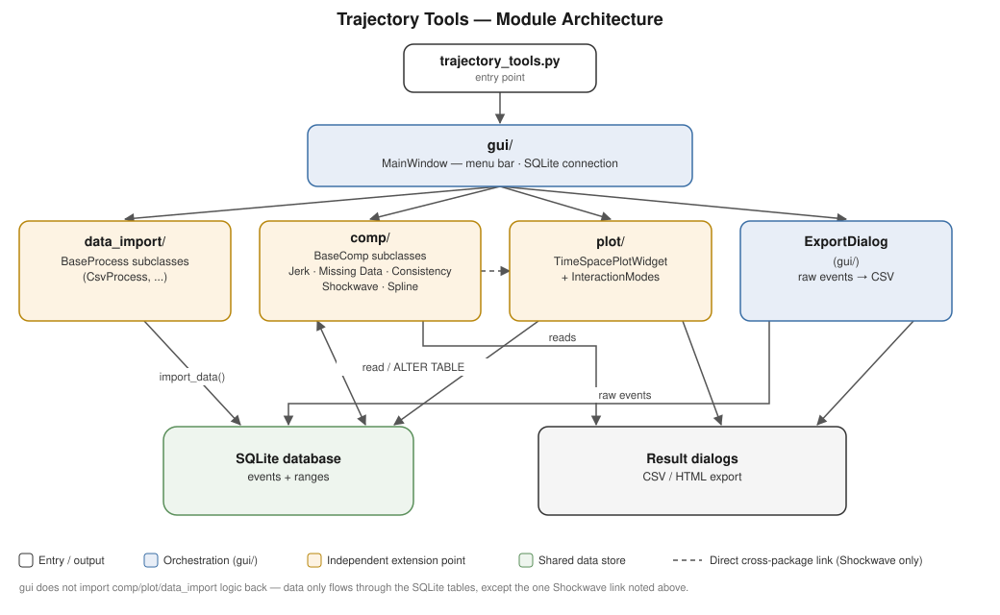

# Trajectory Research, Analysis, Correction, Exploration, and Simulation (TRACES)

TRACES is a pre-release desktop application for importing, exploring, and analyzing vehicle trajectory data. It uses JSON import profiles to normalize different CSV layouts into SQLite databases, then provides an interactive time-space plot, trajectory-quality analyses, and data export tools through a PyQt6 interface.


## Features

- Import CSV trajectory data with reusable, configuration-driven column mappings.
- Open previously imported `.sqlite` and `.db` trajectory databases.
- Explore events and lanes with linked time and distance filters, pan and zoom controls, hover details, vehicle search, and speed-based coloring.
- Select individual trajectories or groups of trajectories for statistics and time-series plots.
- Measure gaps and headways directly on the plot.
- Identify and fit shockwaves with the semi-automatic interaction mode.
- Run jerk, missing-data, internal-consistency, platoon-consistency, spectral, and B-spline fitting analyses.
- Export complete or selected datasets and analysis results to CSV.
- Export supported analysis plots as self-contained HTML files with embedded SVG.

## How it works

```text
CSV data + JSON import profile
             |
             v
   Configured import processor
             |
             v
 SQLite events + ranges tables
       |                 |
       v                 v
 Interactive plots   Analysis modules
       |                 |
       +--------+--------+
                v
          CSV / HTML output
```

The `events` table is configuration-driven, but every imported dataset must provide these fields:

| Field | Purpose |
|---|---|
| `event_id` | Identifies a collection event or run. |
| `veh_id` | Identifies a vehicle within an event. |
| `veh_time` | Records the trajectory timestamp in seconds. |
| `lane_id` | Stores the normalized lane identifier. |
| `veh_dist_trav` | Stores longitudinal distance traveled in meters. |

`event_id`, `veh_id`, and `veh_time` form the record key. A second table, `ranges`, stores the per-event summaries used by the event and range selectors. Optional columns such as speed, acceleration, original lane, location, and vehicle dimensions enable additional plots and analyses. Physical values are stored internally in SI units when a supported source unit is declared in the import profile.

## Architecture

`gui` is the orchestration layer: `main_window.py` owns the menu bar and the SQLite connection, and constructs whichever `data_import`, `analysis`, or `plot` component an action requires. Those three packages do not import from each other directly — they only share data through the `events`/`ranges` tables and small cross-cutting helpers in `utils.py`. Two exceptions are called out below: `ExportDialog` writes CSV straight from `events`, and Shockwave fitting is built incrementally through a direct `analysis` ↔ `plot` link rather than through the database.



*Figure: TRACES module architecture.*

Each package is an independent extension point: new file formats implement `BaseProcess`, new analyses implement `BaseComp`, and new plot interactions implement `InteractionMode`. See the [Developer Guide](docs/TRACES-developer-guide.md) for the full architecture overview, data model, and extension recipes.

## Requirements

- Python 3.12
- A desktop environment capable of running PyQt6
- Runtime packages listed in [`requirements.txt`](requirements.txt)
- SciPy for spline fitting (included in `requirements.txt`).

## Run from source

From the repository root:

```bash
python3.12 -m venv .venv
source .venv/bin/activate
python -m pip install --upgrade pip
python -m pip install -r requirements.txt
cd src
python traces.py
```

On Windows, use `py -3.12` to create the environment and `.venv\Scripts\Activate.ps1` to activate it.

> **Working-directory note:** run the development entry point with `src` as the current directory. Development builds currently resolve import profiles, settings, and logs relative to the working directory; running `python src/traces.py` from the repository root will not discover the profiles in `src/config`.

The repository does not include sample CSV or SQLite data. To use the application, provide either:

- a CSV file matching one of the bundled import profiles;
- a CSV file plus a profile written for its column layout; or
- an existing compatible SQLite trajectory database.

## Basic workflow

1. Launch the application and choose **Import Data** for CSV input or **Open Trajectories** for an existing database.
2. For an import, select the profile that matches the CSV layout and choose an output `.sqlite` file.
3. Select an event, time range, and distance range to create the time-space plot.
4. Explore trajectories with the plot controls, right-click tools, and **Mode**, **Data**, and **Analysis** menus.
5. Use **File → Export** to save data or analysis results.

See the [User Guide](docs/TRACES-user-guide.md) for the complete illustrated workflow.

## Import profiles

Import profiles live in [`src/config`](src/config) and define the processor class, source file extension, output columns, transformations, types, and source units. The bundled profiles cover these layouts:

- Ohio single-vehicle and two-vehicle records
- TGSIM L1, L2, moving-sensor, and stationary-sensor records

These profiles are layout adapters, not a restriction on the application. New CSV layouts can be supported with another JSON profile, and new file formats can be added by implementing the `BaseProcess` interface.

For the complete profile schema, supported transformations, unit conversions, and data dictionary, read the [JSON Configuration Guide](docs/TRACES-config-guide.md).

### Configuration locations

- **Source checkout:** `src/config`
- **Packaged Windows application:** `%APPDATA%\TrajectoryTools\config`

Packaged builds copy the bundled profiles into the user configuration directory only when it contains no JSON profiles. Existing user profiles are not overwritten.

## Documentation

| Guide | Audience and contents |
|---|---|
| [User Guide](docs/TRACES-user-guide.md) | Importing, plotting, selecting, analyzing, searching, and exporting through the GUI. |
| [JSON Configuration Guide](docs/TRACES-config-guide.md) | Import-profile structure, required fields, functions, units, and the trajectory data dictionary. |
| [Developer Guide](docs/TRACES-developer-guide.md) | Architecture, data model, extension interfaces, and recipes for new importers, analyses, and interaction modes. |

## Repository layout

| Path | Purpose |
|---|---|
| `src/traces.py` | Application entry point. |
| `src/gui/` | Main window, start screen, and import/export dialogs. |
| `src/data_import/` | Import interfaces, CSV processing, transformations, and unit conversion. |
| `src/plot/` | Time-space plotting, supporting plots, selection, and interaction modes. |
| `src/analysis/` | Trajectory analyses, including platoon consistency, spectral analysis, shockwave, and spline computations. |
| `src/config/` | Bundled JSON import profiles. |
| `tests/` | Unit and GUI tests. |
| `docs/` | User, configuration, and developer guides with screenshots. |

## Development and tests

The repository is a source application rather than an installable Python package: it does not currently include `pyproject.toml`, `setup.py`, or a development requirements file.

After installing the runtime dependencies above, install the test-only packages and run the suite from the repository root:

```bash
python -m pip install pytest pytest-qt
python -m pytest -q
```

For a headless Linux environment:

```bash
QT_QPA_PLATFORM=offscreen python -m pytest -q
```

Some tests at the current revision still target earlier importer and GUI interfaces, so the suite is not yet fully green. When changing behavior, update the corresponding tests and documentation together. The [Developer Guide](docs/TRACES-developer-guide.md) describes the main extension points.

## Windows packaging

The included [GitHub Actions workflow](.github/workflows/build.yml) uses Python 3.12, PyInstaller, and NSIS to create both a portable Windows directory and an installer on each push. The workflow artifacts are retained for seven days; this is a development build pipeline, not a published release channel.

## Project status

TRACES is a version 0.1 proof of concept and should be treated as pre-release software. The current implementation includes the semi-automatic shockwave workflow. Manual and fully automatic shockwave modes are not implemented. Platoon Consistency and Spectral Analysis are available under **Analysis → Noise**, with CSV exports under **File → Export → Export Analysis**.

## License

Licensed under the Apache License, Version 2.0. See [LICENSE](LICENSE) for the full text.

## Contact

For more information, contact CAVSupportServices@dot.gov.

## Platoon Consistency

See [Platoon Consistency](docs/platoon-consistency.md) for the Module 3 workflow, calculation conventions, and validation command.

## Spectral Analysis

See [Spectral Analysis](docs/spectral-analysis.md) for the Module 5 workflow,
DFT conventions, magnitude/amplitude/power plots, CSV export, and validation command.
