# TRACES User Guide

*Trajectory Research, Analysis, Correction, Exploration, and Simulation*

## Table of Contents

- [1. Introduction](#1-introduction)
- [2. Getting Started](#2-getting-started)
- [3. Working with Plots](#3-working-with-plots)
- [4. Opening a Database vs. Importing CSV Data](#4-opening-a-database-vs-importing-csv-data)
- [5. Selecting an Event to Plot](#5-selecting-an-event-to-plot)
- [6. Main Window Tour](#6-main-window-tour)
- [7. The Time-Space Plot](#7-the-time-space-plot)
- [8. Right-Click Menu on the Plot](#8-right-click-menu-on-the-plot)
- [9. Interaction Modes](#9-interaction-modes)
- [10. Changing Data: Write Targets and Row Status](#10-changing-data-write-targets-and-row-status)
- [11. Data Menu — Spline Fitting](#11-data-menu--spline-fitting)
- [12. Data Menu — Gap Interpolation](#12-data-menu--gap-interpolation)
- [13. Data Menu — Lane-Level Anomalies](#13-data-menu--lane-level-anomalies)
- [14. Trajectory Stitching](#14-trajectory-stitching)
- [15. Analysis Menu — Jerk, Missing Data, Internal Consistency, Platoon Consistency, and Spectral Analysis](#15-analysis-menu--jerk-missing-data-internal-consistency-platoon-consistency-and-spectral-analysis)
- [16. Advanced Statistics](#16-advanced-statistics)
- [17. Exporting Data](#17-exporting-data)
- [18. Vehicle Search](#18-vehicle-search)
- [19. System Log Viewer](#19-system-log-viewer)
- [20. About Dialog](#20-about-dialog)

---

## Table of Figures

| Figure | Title | Section |
|---|---|---|
| Figure 1 | TRACES main window showing a populated time-space plot | [1. Introduction](#1-introduction) |
| Figure 2 | Start screen with no recent files | [2. Getting Started](#2-getting-started) |
| Figure 3 | Start screen with recent files populated | [2. Getting Started](#2-getting-started) |
| Figure 4 | Kinematic stacked plot with two plots in view | [3. Working with Plots](#3-working-with-plots) |
| Figure 5 | Hover cursor and value labels on a kinematic stacked plot | [3. Working with Plots](#3-working-with-plots) |
| Figure 6 | File menu showing Open, Recent, and Import | [4. Opening a Database vs. Importing CSV Data](#4-opening-a-database-vs-importing-csv-data) |
| Figure 7 | Import dialog with input file selected, ready to import | [4. Opening a Database vs. Importing CSV Data](#4-opening-a-database-vs-importing-csv-data) |
| Figure 8 | Import dialog mid-import with progress | [4. Opening a Database vs. Importing CSV Data](#4-opening-a-database-vs-importing-csv-data) |
| Figure 9 | Import completion popup on success | [4. Opening a Database vs. Importing CSV Data](#4-opening-a-database-vs-importing-csv-data) |
| Figure 10 | Time Space Plot Settings dialog for a newly opened database | [5. Selecting an Event to Plot](#5-selecting-an-event-to-plot) |
| Figure 11 | Vehicle Limit Exceeded warning dialog | [5. Selecting an Event to Plot](#5-selecting-an-event-to-plot) |
| Figure 12 | Data menu | [6. Main Window Tour](#6-main-window-tour) |
| Figure 13 | Analysis menu with the Noise submenu open | [6. Main Window Tour](#6-main-window-tour) |
| Figure 14 | Mode menu open with Time-Space Diagram checked | [6. Main Window Tour](#6-main-window-tour) |
| Figure 15 | Help menu with the available interaction help topics | [6. Main Window Tour](#6-main-window-tour) |
| Figure 16 | Time-Space Diagram help window | [6. Main Window Tour](#6-main-window-tour) |
| Figure 17 | Time-space plot with data loaded, no selection | [7. The Time-Space Plot](#7-the-time-space-plot) |
| Figure 18 | Time-space plot with Show Speed enabled and a selection active | [7. The Time-Space Plot](#7-the-time-space-plot) |
| Figure 19 | Right-click menu in the "All" context with the Statistics submenu | [8. Right-Click Menu on the Plot](#8-right-click-menu-on-the-plot) |
| Figure 20 | Noise Analysis submenu expanded | [8. Right-Click Menu on the Plot](#8-right-click-menu-on-the-plot) |
| Figure 21 | Right-click menu in the "Series" context with the Stitching submenu | [8. Right-Click Menu on the Plot](#8-right-click-menu-on-the-plot) |
| Figure 22 | Gap Headway mode with a locked overlay | [9. Interaction Modes](#9-interaction-modes) |
| Figure 23 | Shockwave configuration dialog | [9. Interaction Modes](#9-interaction-modes) |
| Figure 24 | Shockwave chain under construction | [9. Interaction Modes](#9-interaction-modes) |
| Figure 25 | Committed shockwave with the floating results panel | [9. Interaction Modes](#9-interaction-modes) |
| Figure 26 | Shockwave results table | [9. Interaction Modes](#9-interaction-modes) |
| Figure 27 | Write Changes prompt on the first change to a database | [10. Changing Data: Write Targets and Row Status](#10-changing-data-write-targets-and-row-status) |
| Figure 28 | Event selection list | [11. Data Menu — Spline Fitting](#11-data-menu--spline-fitting) |
| Figure 29 | Spline Fitting parameter dialog | [11. Data Menu — Spline Fitting](#11-data-menu--spline-fitting) |
| Figure 30 | Spline Fit Statistics results table | [11. Data Menu — Spline Fitting](#11-data-menu--spline-fitting) |
| Figure 31 | Right-click Spline Fitting preview dialog | [11. Data Menu — Spline Fitting](#11-data-menu--spline-fitting) |
| Figure 32 | Gap Interpolation configuration dialog | [12. Data Menu — Gap Interpolation](#12-data-menu--gap-interpolation) |
| Figure 33 | Gap Review window with an automatically filled gap selected | [12. Data Menu — Gap Interpolation](#12-data-menu--gap-interpolation) |
| Figure 34 | Gap Review window previewing new spline parameters with View | [12. Data Menu — Gap Interpolation](#12-data-menu--gap-interpolation) |
| Figure 35 | Gap Review window in Add Points mode | [12. Data Menu — Gap Interpolation](#12-data-menu--gap-interpolation) |
| Figure 36 | Gap Review window after Apply: the gap is manually filled | [12. Data Menu — Gap Interpolation](#12-data-menu--gap-interpolation) |
| Figure 37 | Select Anomalies to Identify dialog | [13. Data Menu — Lane-Level Anomalies](#13-data-menu--lane-level-anomalies) |
| Figure 38 | Lane-Level Anomalies review panel: a Proximity anomaly with a fix set up | [13. Data Menu — Lane-Level Anomalies](#13-data-menu--lane-level-anomalies) |
| Figure 39 | Lane-Level Anomalies review panel: a Rapid Lane Change anomaly with a fix set up | [13. Data Menu — Lane-Level Anomalies](#13-data-menu--lane-level-anomalies) |
| Figure 40 | Lane-Level Anomalies review panel after Apply | [13. Data Menu — Lane-Level Anomalies](#13-data-menu--lane-level-anomalies) |
| Figure 41 | Trajectory stitching selection with two trajectories picked | [14. Trajectory Stitching](#14-trajectory-stitching) |
| Figure 42 | Trajectory Stitching preview for an overlapping pair | [14. Trajectory Stitching](#14-trajectory-stitching) |
| Figure 43 | Trajectory Stitching preview for a pair separated by a gap | [14. Trajectory Stitching](#14-trajectory-stitching) |
| Figure 44 | Trajectory Stitching preview showing a safety warning | [14. Trajectory Stitching](#14-trajectory-stitching) |
| Figure 45 | Jerk Analysis parameter dialog | [15. Analysis Menu — Jerk, Missing Data, Internal Consistency, Platoon Consistency, and Spectral Analysis](#15-analysis-menu--jerk-missing-data-internal-consistency-platoon-consistency-and-spectral-analysis) |
| Figure 46 | Jerk Analysis box plot results | [15. Analysis Menu — Jerk, Missing Data, Internal Consistency, Platoon Consistency, and Spectral Analysis](#15-analysis-menu--jerk-missing-data-internal-consistency-platoon-consistency-and-spectral-analysis) |
| Figure 47 | Missing Data parameter dialog | [15. Analysis Menu — Jerk, Missing Data, Internal Consistency, Platoon Consistency, and Spectral Analysis](#15-analysis-menu--jerk-missing-data-internal-consistency-platoon-consistency-and-spectral-analysis) |
| Figure 48 | Internal Consistency combined results dialog | [15. Analysis Menu — Jerk, Missing Data, Internal Consistency, Platoon Consistency, and Spectral Analysis](#15-analysis-menu--jerk-missing-data-internal-consistency-platoon-consistency-and-spectral-analysis) |
| Figure 49 | Platoon Consistency results table | [15. Analysis Menu — Jerk, Missing Data, Internal Consistency, Platoon Consistency, and Spectral Analysis](#15-analysis-menu--jerk-missing-data-internal-consistency-platoon-consistency-and-spectral-analysis) |
| Figure 50 | Spectral Analysis magnitude spectrum | [15. Analysis Menu — Jerk, Missing Data, Internal Consistency, Platoon Consistency, and Spectral Analysis](#15-analysis-menu--jerk-missing-data-internal-consistency-platoon-consistency-and-spectral-analysis) |
| Figure 51 | Spectral Analysis all-bin results table | [15. Analysis Menu — Jerk, Missing Data, Internal Consistency, Platoon Consistency, and Spectral Analysis](#15-analysis-menu--jerk-missing-data-internal-consistency-platoon-consistency-and-spectral-analysis) |
| Figure 52 | Advanced Statistics parameter dialog | [16. Advanced Statistics](#16-advanced-statistics) |
| Figure 53 | Advanced Statistics results table | [16. Advanced Statistics](#16-advanced-statistics) |
| Figure 54 | Generate Plots variable selection | [16. Advanced Statistics](#16-advanced-statistics) |
| Figure 55 | Advanced Statistics box plots | [16. Advanced Statistics](#16-advanced-statistics) |
| Figure 56 | Export Selected dialog | [17. Exporting Data](#17-exporting-data) |
| Figure 57 | Export Analysis submenu | [17. Exporting Data](#17-exporting-data) |
| Figure 58 | Export completion dialog | [17. Exporting Data](#17-exporting-data) |
| Figure 59 | Vehicle Search dialog with a filtered result list | [18. Vehicle Search](#18-vehicle-search) |
| Figure 60 | System Log Viewer window | [19. System Log Viewer](#19-system-log-viewer) |
| Figure 61 | About dialog | [20. About Dialog](#20-about-dialog) |

---

## 1. Introduction

TRACES — Trajectory Research, Analysis, Correction, Exploration, and Simulation — is a desktop application for importing, visualizing, analyzing, and correcting vehicle trajectory data: the detailed, time-stamped position records produced by cameras, radar, connected-vehicle systems, and other sensing technologies used in traffic research.

As trajectory data has become more widely available, so has the need for a tool that can bring data from different sources into one consistent format and make it usable without custom scripting for every dataset. TRACES addresses that need with a modular, configuration-driven approach: any CSV file whose columns are described in a JSON configuration file can be imported into a common SQLite database structure, then explored and analyzed the same way regardless of where the data originated.

Once data is imported, TRACES centers on an interactive **time-space plot** — vehicle position plotted against time — that supports zooming, trajectory selection, and a set of interaction modes for tasks like measuring gaps and headways or identifying shockwaves. Built-in analyses (jerk, missing data, internal consistency, spline-based smoothing, and leader/follower and lane-change statistics) can be run against one or more events, with results shown as tables, statistics, and plots that can be exported to HTML and CSV files for use elsewhere.

TRACES can also **correct** trajectory data: fill missing observations by spline interpolation, reassign lanes where lane-level anomalies are found, and stitch together trajectory segments that belong to the same vehicle. Corrections never delete the original observations — each changed row is marked, the values it replaced are kept, and every correction can be undone (see [Section 10](#10-changing-data-write-targets-and-row-status)).

This guide is intended for those with a background in vehicle kinematic probe data and related statistical analysis methods. It walks through the application in the order you're likely to use it: importing data, visualizing data plots, correcting data, running analyses, and exporting results. For details on writing a JSON configuration file for a new CSV format, see the separate *TRACES Configuration Guide*.

*Figure 1 TRACES main window showing a populated time-space plot*

---

## 2. Getting Started

### Launching the Application

Start TRACES from its shortcut or executable like any other desktop application. On first launch the window opens at 80% of your screen size, centered; on subsequent launches it restores the size and position (including maximized state) from your last session.

### The Start Screen

TRACES opens to a start screen with two options and a recent-files list:

- **Open Trajectories** — open an existing trajectory database (a `.sqlite` file previously created by importing CSV data).
- **Import Data** — import a new CSV file into a new trajectory database.
- **Recent Trajectories** — up to seven previously opened databases, most recent first, shown by filename and full path. Click any entry to open it directly. If none exist yet, this section reads "No recent files."

*Figure 2 Start screen with no recent files*

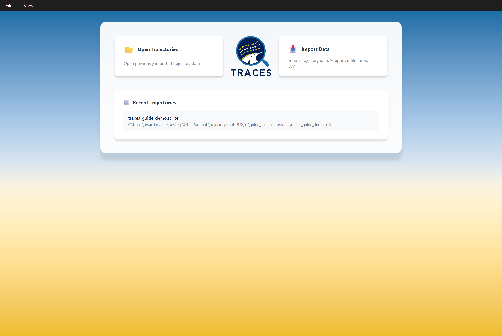

*Figure 3 Start screen with recent files populated*

These same two actions are also available from the **File** menu (**Open** and **Import**), covered in [Section 4](#4-opening-a-database-vs-importing-csv-data).

---

## 3. Working with Plots

TRACES shows data in several kinds of plots. They share a common set of mouse and keyboard controls, so it's worth knowing what to expect before looking at any one of them.

### Pan and Zoom

Most plots — the Time-Speed and Time-Accel plots, the analysis result plots, the box plots, and the plots in the Gap Interpolation, Lane-Level Anomalies, Spline Fitting, and Trajectory Stitching windows — behave the way you'd expect:

- **Drag** inside the plot to pan.
- **Scroll the mouse wheel** inside the plot to zoom in or out around the cursor.
- **Hover over an axis and scroll** to zoom only that axis — for example, scroll over the time axis to stretch or compress time without changing the vertical scale. Dragging over an axis pans only that axis.
- Click the small **"A"** button in a plot's lower-left corner to return to the automatic, fit-to-data view.

Where a plot has a **legend**, clicking a legend entry hides or shows that series.

### The Time-Space Plot Is Different

The main time-space plot ([Section 7](#7-the-time-space-plot)) does **not** pan by dragging, because click-and-drag is how you select trajectories in its default Time-Space Diagram mode. Instead, its visible window is controlled by the **Time (s)** slider below the plot and the **Dist (m)** slider to its right: drag a slider's handles to narrow or widen the window, or drag the slider between its handles to move (pan) the window. The mouse wheel still zooms — over the plot both axes zoom together around the cursor, and over an axis only that axis zooms — and the sliders follow every zoom. The Time-Speed and Time-Accel plots use the same pair of sliders, but because they have no selection mode they also pan by dragging.

### Kinematic Stacked Plots

Several windows show distance, speed, acceleration, and/or jerk as a **stack of plots that share one time axis**: the Spline Fitting preview, the Internal Consistency results, the Gap Review window, and the Trajectory Stitching preview. Panning or zooming time on any plot moves every plot in the stack together, while each plot keeps its own vertical axis, fitted to its data. Every plot shows its own time axis, so a plot remains readable on its own.

When there are more plots than fit comfortably, you choose how many are in view:

- Click a plot first so the stack has keyboard focus, then press a **number key 1–9** to show that many plots at a time, or **0** to show all of them.
- With fewer than all plots in view, scroll through the stack one plot at a time with **Page Up / Page Down**, the scroll bar, or **Shift + mouse wheel** over a plot. (The plain wheel keeps zooming.)

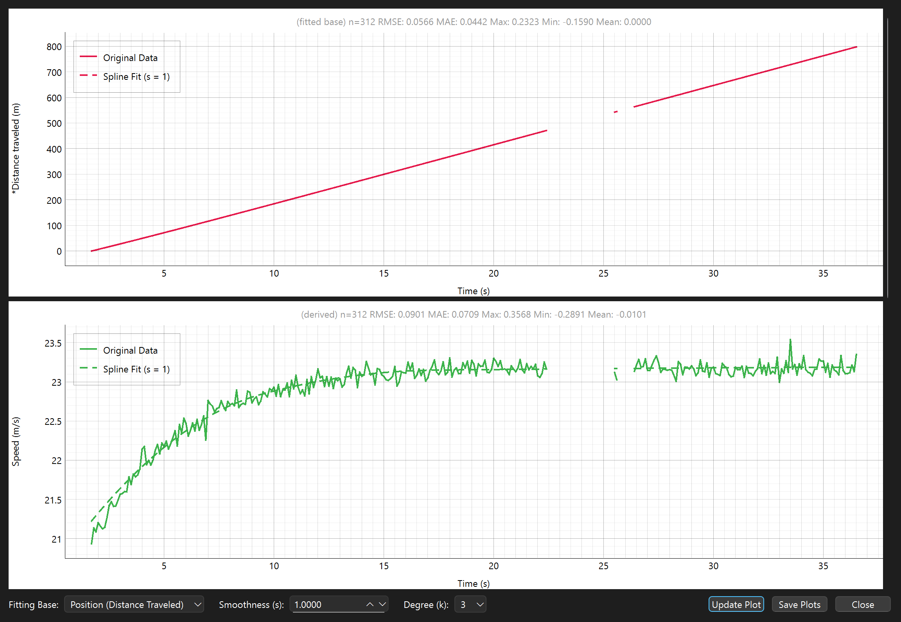

*Figure 4 Kinematic stacked plot with two plots in view*

Moving the mouse over a plot draws a thin vertical **cursor** at that time on every plot in the stack. When the pointer is near a visible curve, each plot also shows a small label listing the time and the value of each of its visible series at that instant — a quick way to compare, say, measured and fitted speed at the same moment.

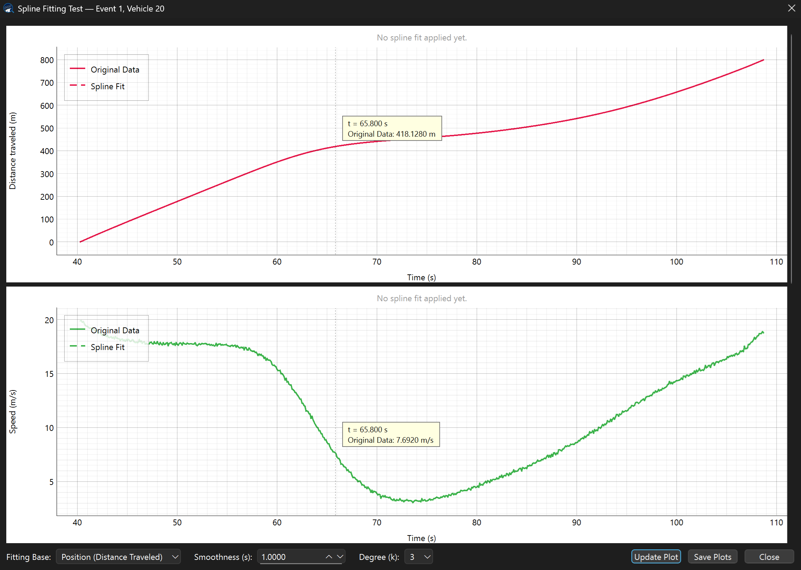

*Figure 5 Hover cursor and value labels on a kinematic stacked plot*

Legend entries in a stacked plot toggle a series either on every plot at once (for example, "Original Data" and "Spline Fit" in the Spline Fitting preview) or on one plot only (for example, Traj 1 and Traj 2 in the stitching preview); each window's section notes which.

### Saving Plots as Interactive HTML

Windows with a **Save Plots** or **Save** button for plots write a self-contained HTML page that you can open in any browser. The page keeps the same interactions: wheel to zoom (over an axis, that axis only), drag to pan, double-click to reset, hover for values, and click legend entries to show or hide series.

---

## 4. Opening a Database vs. Importing CSV Data

TRACES works with two kinds of files:

- **CSV files** — raw trajectory data as originally collected, in whatever column layout your source provides.
- **SQLite databases** (`.sqlite`) — the application's own standardized format, created by importing a CSV file once. All of the plotting, analysis, correction, and export features work against this database, not the original CSV.

You'll typically import a CSV once, then reopen the resulting database directly on future sessions.

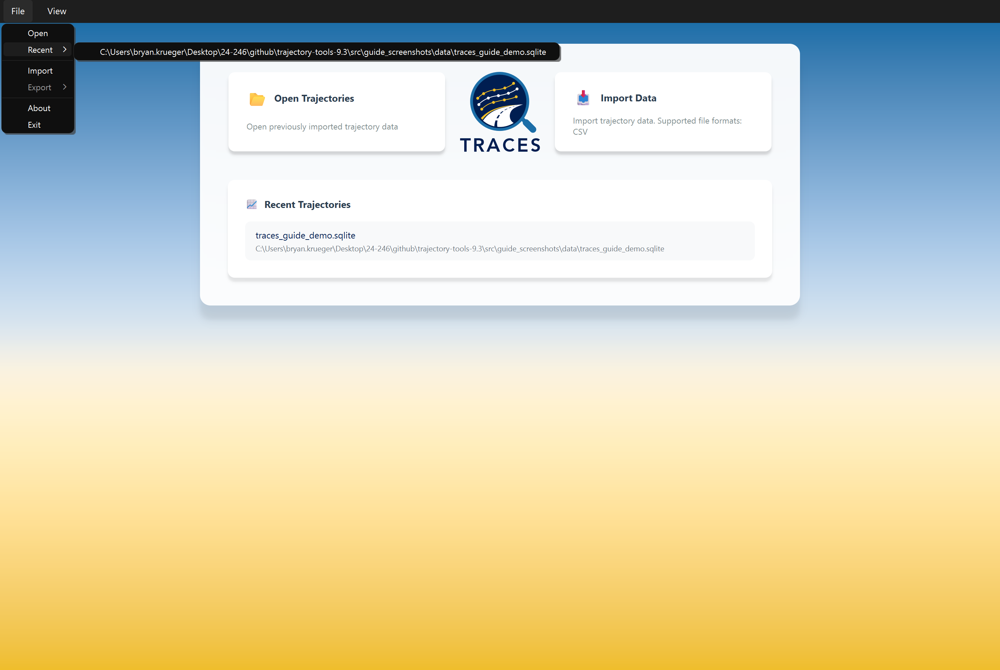

*Figure 6 File menu showing Open, Recent, and Import*

### 4.1 Opening an Existing Database

Use **File → Open**, choose an entry from **File → Recent** (up to seven, most recent first), or click **Open Trajectories** on the start screen. All three lead to the same place.

For File → Open, a standard file dialog is filtered to `.sqlite` / `.db` files. Once a file is chosen, TRACES validates it before doing anything else:

- it must contain an `events` table with the required columns (`event_id`, `veh_id`, `veh_time`, `lane_id`, `veh_dist_trav`),
- it must contain a `ranges` table (this is written last during import, so its presence confirms the import completed),
- the `events` table must have at least one record.

If any check fails, an error dialog explains specifically what's wrong (e.g. a missing `ranges` table suggests the source import didn't finish and should be re-run) and the file is not opened.

On success, the window title updates to show the file path, the file moves to the top of the Recent list, and the **[Time Space Plot Settings dialog](#5-selecting-an-event-to-plot)** opens automatically so you can choose what to plot. If you cancel that dialog instead of applying settings, the database is closed again and you're returned to the start screen — TRACES never leaves a database "open" in the background without a plot attached to it.

### 4.2 Importing CSV Data

Use **File → Import** or click **Import Data** on the start screen to open the Import dialog.

**Configuration files.** Before anything can be imported, TRACES needs at least one JSON configuration file describing a CSV layout, kept in the application's `config` folder. On first launch, TRACES copies its bundled configurations into that folder; your own configurations there are never overwritten. On opening, the dialog scans the folder, validates each `.json` file it finds, and lists the valid ones as available file types (by filename). Configurations that fail validation are excluded and reported in the log. Writing these configuration files is covered in the separate *TRACES Configuration Guide* — this guide only covers using the Import dialog itself.

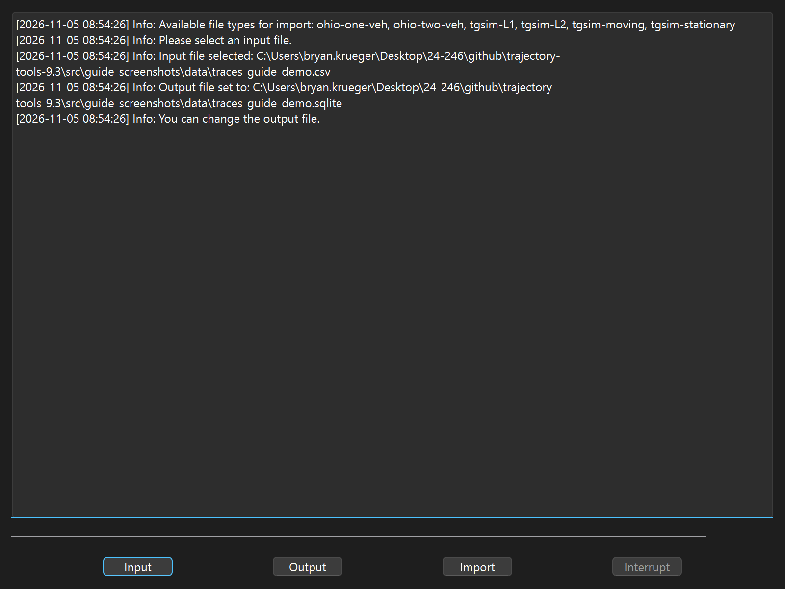

*Figure 7 Import dialog with input file selected, ready to import*

**Running an import:**

1. Click **Input** and choose a CSV file. The file type filter is built from your available configurations. The output database path is set automatically (same name, `.sqlite` extension) but can be changed with **Output**.
2. Click **Import** to begin. The configuration is fully re-validated (this time every message is logged, including informational ones about column mappings), then the import runs on a background thread so the dialog stays responsive.
3. The log area streams timestamped progress, warnings, and errors; the progress bar advances as records are processed. **Interrupt** stops the import after a confirmation prompt — an interrupted or failed import removes the partial output file rather than leaving a corrupt database behind.

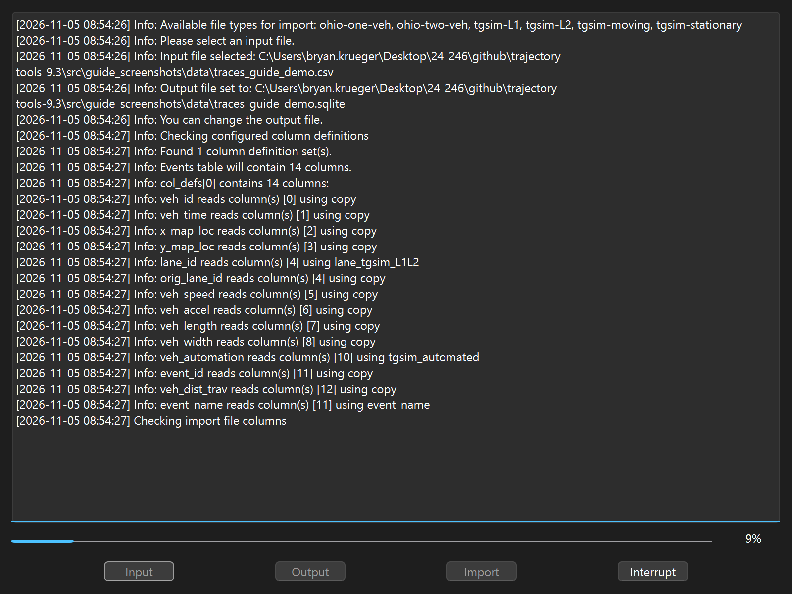

*Figure 8 Import dialog mid-import with progress*

**When it finishes**, a completion popup appears:

- **Success** — "Continue" closes the Import dialog and opens the Time Space Plot Settings dialog for the new database (same as opening it directly); "Back" returns to the Import dialog so you can import another file in the same session.
- **Failure** — only "Back" is offered, so you can review the log to see what went wrong before trying again.

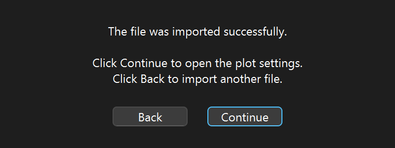

*Figure 9 Import completion popup on success*

Duplicate records (identical `event_id`, `veh_id`, and `veh_time`) are silently skipped rather than duplicated, so re-running an import over the same data is safe.

---

## 5. Selecting an Event to Plot

Whenever a database is opened — via File → Open, a Recent entry, or right after a successful import — TRACES shows the **Time Space Plot Settings** dialog before displaying anything. This dialog is where you choose *which* event to look at and *how much* of it to plot. It reappears any time you click the **event button** at the top of the plot itself, so you can change events or narrow your range later without starting over.

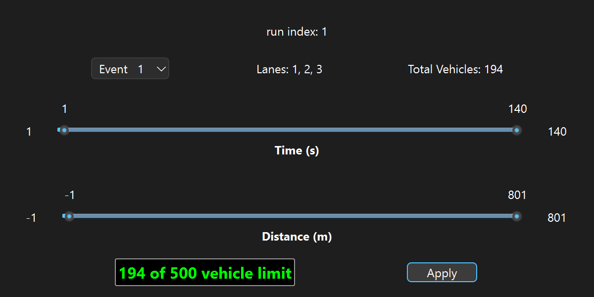

*Figure 10 Time Space Plot Settings dialog for a newly opened database*

### Choosing an Event

The **Event** dropdown lists every event found in the database (from its `ranges` table), labeled `Event N`. Selecting one updates:

- the event name label at the top (or blank if the configuration didn't provide one),
- **Lanes** — the lane IDs present in the event; hover for a tooltip showing original source-lane IDs, if your configuration preserved them,
- **Total Vehicles** — the full vehicle count for the event, independent of any range filtering,
- both range sliders, reset to the event's full time and distance extent.

### Narrowing the Range

The **Time (s)** and **Distance (m)** sliders each have two handles, letting you filter to a sub-range of the event rather than plotting everything at once. They're linked to each other: releasing the time slider re-queries the actual distance extent of vehicles present within that time window and snaps the distance slider to fit (and releasing the distance slider does the same for time). This makes it easy to zero in on a busy or interesting window on one axis without having to guess the corresponding range on the other.

### The Vehicle Count Limit

Below the sliders, a label reads **"N of 500 vehicle limit"** and updates every time either slider is released, counting the distinct vehicles that fall within the current time *and* distance window. It's colored green while at or under 500 and red when over. This limit is advisory, not a hard cap — it exists because plotting a very large number of trajectories at once can slow the plot down.

If you click **Apply** while over the limit, a warning dialog tells you how many vehicles are selected and asks whether to continue anyway (**OK**) or go back and narrow the range further (**Cancel**, the default).

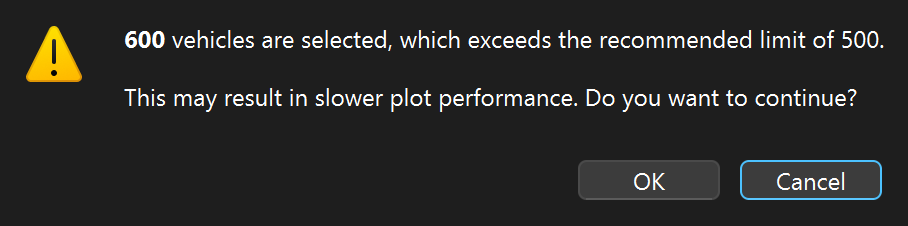

*Figure 11 Vehicle Limit Exceeded warning dialog*

### Applying Settings

**Apply** is always enabled. Once confirmed (directly, or after accepting the over-limit warning), the dialog closes and the main window either builds the time-space plot for the first time or updates the existing one with the new event/range.

If you cancel this dialog instead:
- **On first open** (right after opening or importing a database, before any plot exists), the database is closed and you're returned to the start screen — TRACES doesn't leave a database open with nothing plotted.
- **On later reopens** (via the plot's event button), canceling simply leaves the plot exactly as it was; nothing is lost.

### Reopening Later

Click the event button at the top of the time-space plot at any time to bring this dialog back up. It reopens pre-filled with the currently active event, time range, and distance range as a starting point, so you can adjust the filters without losing your place — see [Section 7](#7-the-time-space-plot) for where this button lives on the plot itself.

---

## 6. Main Window Tour

Before diving into each feature in depth, here's the layout of the main window: what's on the menu bar, when each menu appears, and where to find the full details later in this guide.

### Window Title and Database State

The title bar reads **"TRACES"** at the start screen and becomes **"TRACES - `<file path>`"** once a database is open. Opening a different database while one is already active (via File → Open, Recent, or Import) doesn't open a second window — it reuses the same plot area, closing the previous connection and loading the newly opened database's data in place once you confirm an event in the settings dialog. If you choose to save changes to a copy of the database ([Section 10](#10-changing-data-write-targets-and-row-status)), the title switches to the copy's path.

### Menu Availability at a Glance

| Menu | Visible at start | Becomes available when… | Covered in |
|------|------------------|--------------------------|------------|
| **File** | Yes, always | — | §4, §17, §20 |
| **View** | Yes, always (Search Vehicle item stays disabled until an event is confirmed) | — | §18, §19 |
| **Data** | Hidden | Time Space Plot Settings dialog is accepted | §11, §12, §13 |
| **Analysis** | Hidden | Time Space Plot Settings dialog is accepted | §15 |
| **Mode** | Hidden | a plot has actually been created (first event confirmed) | §9 |

Canceling out of a database entirely (see §5) hides Data, Analysis, and Mode again and returns the window to this starting state.

### File Menu

- **Open**, **Recent** (up to 7 entries; grayed out when empty), and **Import** are always available — see [§4](#4-opening-a-database-vs-importing-csv-data).
- **Export** — All / Selected / Analysis (Jerk Analysis, Missing Data, Internal Consistency, Platoon Consistency, Spectral Analysis) — stays grayed out until a database is open. Covered in [§17](#17-exporting-data).
- **About** and **Exit** are always available — see [§20](#20-about-dialog).

### View Menu

- **Search Vehicle** is only enabled while the plot is in Time-Space Diagram mode *and* an event is confirmed; it's automatically disabled (and its dialog closed) the moment you switch to Gap Headway or Shockwave mode, or while the settings dialog is open. See [§18](#18-vehicle-search).
- **Log** is always available and opens the modeless System Log Viewer. See [§19](#19-system-log-viewer).

### Data Menu

The Data menu holds the modules that add to or correct the trajectory data itself:

- **Spline Fitting** — first asks you to select one or more events, then fits splines to every trajectory in them and writes calculated kinematics to the database. See [§11](#11-data-menu--spline-fitting).
- **Gap Interpolation** — detects missing observations in the currently plotted event and fills them by spline interpolation, with a review window for refining each gap. See [§12](#12-data-menu--gap-interpolation).
- **Lane-Level Anomalies** — detects implausible lane assignments in the currently plotted event and lets you correct them. See [§13](#13-data-menu--lane-level-anomalies).

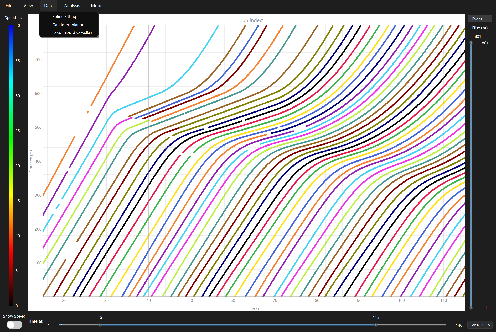

*Figure 12 Data menu*

The fourth correction module, **Trajectory Stitching**, works on trajectories you pick on the plot, so it's on the right-click menu instead ([§14](#14-trajectory-stitching)).

### Analysis Menu

The Analysis menu has a **Noise** submenu (the same list as the right-click Noise Analysis submenu). **Jerk Analysis**, **Missing Data**, **Internal Consistency**, **Platoon Consistency** and **Spectral Analysis** each run against whichever event is currently plotted when launched from this menu (running them against other events requires the right-click plot menu or Export Analysis — see [§8](#8-right-click-menu-on-the-plot) and [§17](#17-exporting-data)). Full details in [§15](#15-analysis-menu--jerk-missing-data-internal-consistency-platoon-consistency-and-spectral-analysis).

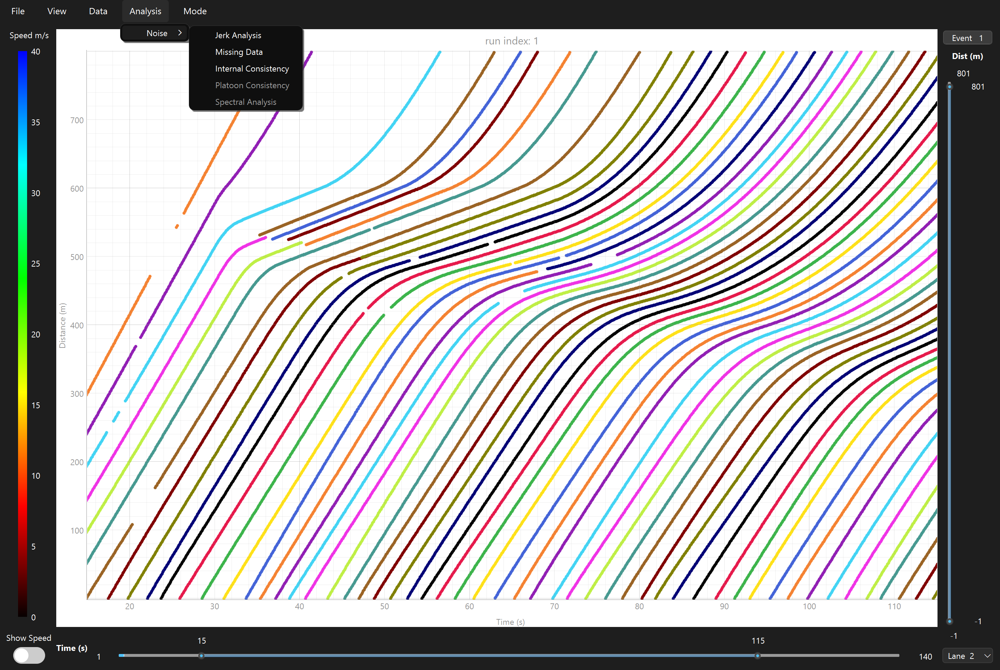

*Figure 13 Analysis menu with the Noise submenu open*

### Mode Menu

Populated only once a plot exists, with three mutually exclusive, checkable actions: **Time-Space Diagram** (the default), **Gap Headway**, and **Shockwave**. Selecting Shockwave first prompts for configuration; only its **Semi-Automatic** method is currently implemented — Manual and Automatic appear in that configuration dialog but are disabled for now. Full behavior in [§9](#9-interaction-modes).

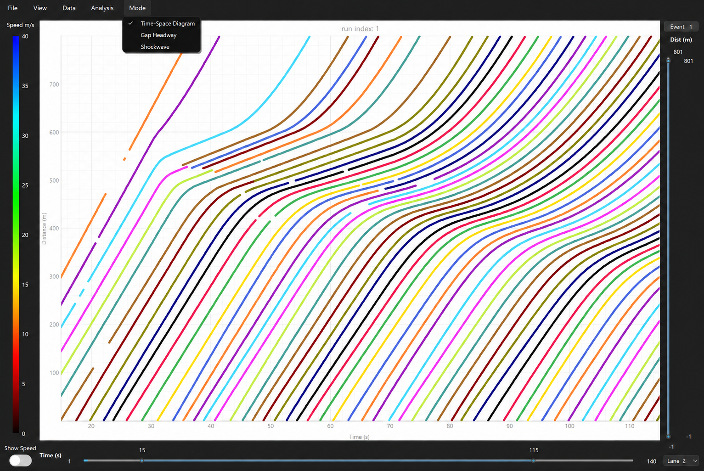

*Figure 14 Mode menu open with Time-Space Diagram checked*

### Help Menu

**Help**, immediately to the right of **Mode**, provides **Time-Space Diagram**, **Gap Headway**, and **Shockwave** entries. Each opens a separate help window listing the mouse and keyboard controls, including Shockwave's Ctrl+left-click editing and Ctrl+right-click deletion. These windows can stay open while you use the plot, and each has a **Close** button. Opening Help does not change the active mode. Help is also available before a database is opened.

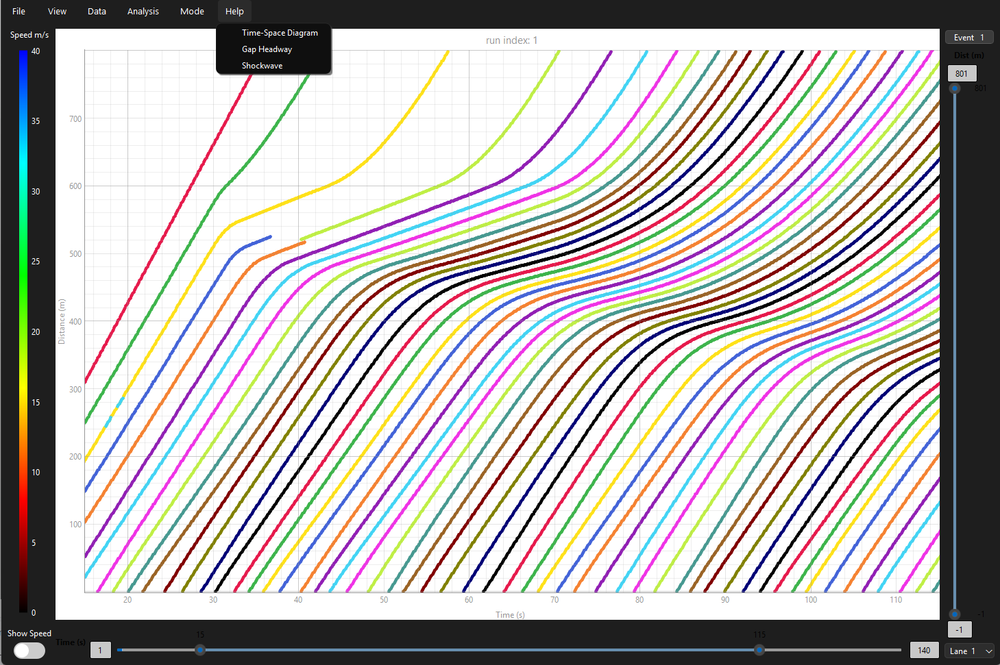

*Figure 15 Help menu with the available interaction help topics*

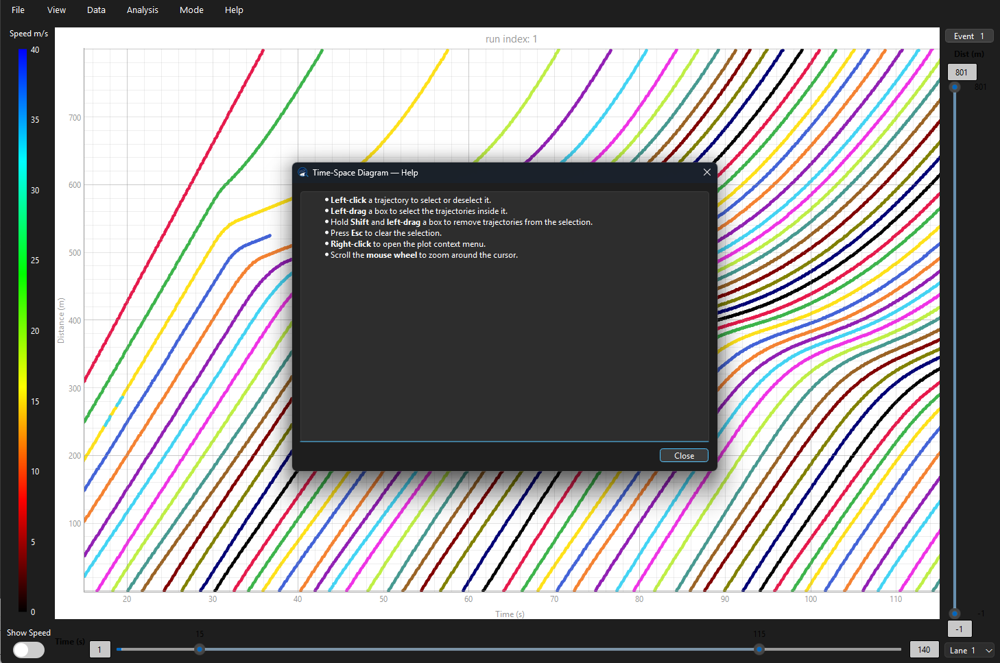

*Figure 16 Time-Space Diagram help window*

---

## 7. The Time-Space Plot

The time-space plot is the application's central view: vehicle position (distance traveled) plotted against time, one point per recorded observation, one lane at a time.

*Figure 17 Time-space plot with data loaded, no selection*

### Layout

- **Left — Speed gradient.** A vertical color-scale legend (0–40 m/s by default) paired with a **Show Speed** toggle switch. Off by default; when on, every plotted point is colored by its instantaneous speed instead of by vehicle, letting you spot slow/fast regions at a glance. See "Coloring by Speed" below.
- **Center — Plot canvas and time range.** The scatter plot itself (time on the x-axis, distance on the y-axis), with a horizontal two-handle **Time (s)** slider directly beneath it controlling the visible time window. (When Shockwave mode is active, two additional sliders — Min Slope Change and Vicinity — appear here; see [§9](#9-interaction-modes).)
- **Right — Event, distance, and lane.** The **event button** at the top reopens the [Time Space Plot Settings dialog](#5-selecting-an-event-to-plot) to change events or ranges; below it, a vertical two-handle **Dist (m)** slider controls the visible distance window; below that, a **lane** dropdown selects which lane's trajectories are currently plotted.

The plot always shows one lane at a time — switch lanes from the dropdown to see another. The plot title shows the event's name (or "Event N" if none was configured).

Trajectories that were combined by [Trajectory Stitching](#14-trajectory-stitching) are never plotted as their original segments — only the stitched trajectory appears. Gap fills ([§12](#12-data-menu--gap-interpolation)) and lane corrections ([§13](#13-data-menu--lane-level-anomalies)) appear as part of the trajectories they belong to, and the plot reloads automatically when one of those windows closes after making changes.

### Panning and Zooming

As described in [Section 3](#3-working-with-plots), the time and distance sliders are the way to pan: drag a handle to narrow the range, or drag the slider between its handles to shift the window. Scrolling the mouse wheel over the plot zooms in or out centered on the cursor position, adjusting both sliders together to preserve the plot's aspect ratio; scrolling over the time or distance axis zooms only that axis. Zooming is limited to a minimum span on each axis — you can't zoom in indefinitely — and is clamped so you can't pan past the event's full extent. Click-and-drag on the plot is reserved for selection, so the plot doesn't pan by dragging.

### Hovering for Detail

Hovering near a point shows a tooltip with that vehicle's ID, time, lane, distance, speed, acceleration, automation status, and length (where those columns are present in your imported data — see the *TRACES Configuration Guide*, section "Data Dictionary", for which columns are optional).

### Selecting Trajectories

In the default **Time-Space Diagram** mode ([§9](#9-interaction-modes)):

- **Click** near a point to toggle that vehicle's selection on or off.
- **Drag** to draw a selection box; every vehicle with at least one point inside it is added to the selection. **Shift+drag** removes the vehicles inside the box from the selection instead.
- Once anything is selected, unselected vehicles are dimmed to a flat gray so the selection stands out. Selecting *every* vehicle in the lane automatically clears the selection and returns to normal coloring, since dimming nothing is equivalent to no selection.

Your selection determines what several right-click menu items act on — one vehicle, a specific selected group, or all — covered next in [§8](#8-right-click-menu-on-the-plot).

### Coloring by Speed

Toggling **Show Speed** on the left replaces each vehicle's flat color with a per-point color drawn from the gradient legend, based on that point's recorded speed (points without a speed value, or where the dataset has no `veh_speed` column, are shown at the low end of the gradient). Dimming from an active selection still applies on top of the gradient — dimmed points stay flat gray regardless of speed.

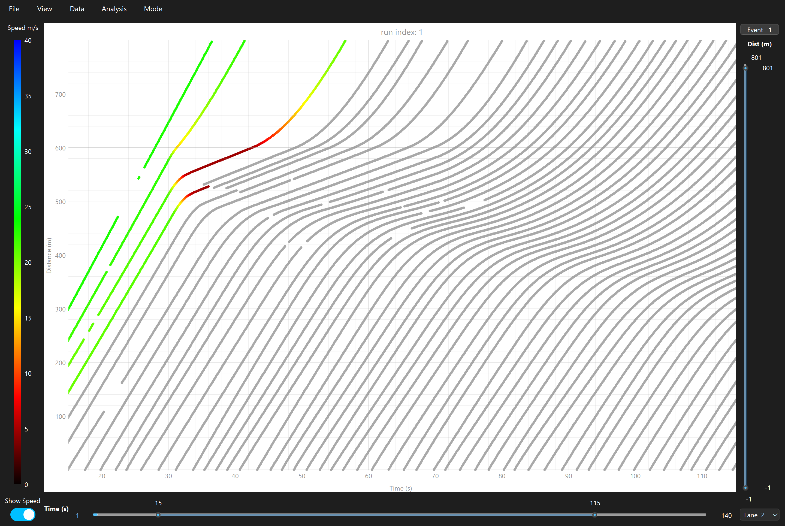

*Figure 18 Time-space plot with Show Speed enabled and a selection active*

---

## 8. Right-Click Menu on the Plot

Right-clicking anywhere on the plot canvas opens a context menu. Its title and the vehicles it acts on depend on where you clicked and what's currently selected:

| Context | When it applies | Vehicles acted on |
|---------|------------------|--------------------|
| **Series** | You right-click directly on a trajectory | Just that one vehicle, regardless of any existing selection |
| **Selected** | You right-click empty space while one or more vehicles are selected | Every currently selected vehicle |
| **All** | You right-click empty space with nothing selected | Every vehicle currently plotted in the visible lane |

The context name appears as a non-clickable heading at the top of the menu, so you always know which of the three you're in before choosing an item. Items that don't apply in the current context are grayed out; hover over one to see why.

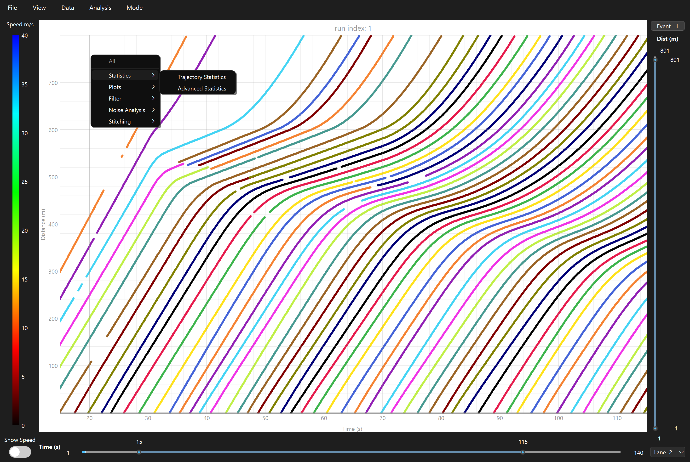

*Figure 19 Right-click menu in the "All" context with the Statistics submenu*

### Statistics

Available in every context, with two entries:

- **Trajectory Statistics** opens a table of summary statistics (speed and acceleration) for the target vehicle(s). If the dataset has neither `veh_speed` nor `veh_accel`, the dialog explains that no statistics can be computed instead of showing an empty table.
- **Advanced Statistics** computes leader/follower and lane-change statistics for the target vehicle(s) — see [§16](#16-advanced-statistics). In the "All" context it covers every vehicle of the event in every lane, not just the lane on screen.

### Plots

**Time-Speed Plot** and **Time-Accel Plot** open a plot of the target vehicle(s)' speed or acceleration over time, for the current lane and the plot's active time range. Both are restricted to the **Selected** and **Series** contexts — you need something selected or clicked on, since plotting "All" would rarely be useful — and each requires the corresponding `veh_speed` or `veh_accel` column to exist in your imported data; if it doesn't, the item is grayed out with a tooltip naming the missing column.

### Filter — Spline Fitting

Opens a preview-only spline fitting window for a single trajectory, letting you try different smoothing parameters against the measured data without writing anything to the database (this is the second of two spline fitting entry points — see [§11](#11-data-menu--spline-fitting) for the full comparison with Data → Spline Fitting). This item is available in all three contexts but only enabled when exactly one vehicle is targeted — right-click directly on a trajectory, or narrow a selection down to one vehicle first, to unlock it.

### Noise Analysis

**Jerk Analysis**, **Missing Data**, **Internal Consistency**, and **Platoon Consistency** run the same analyses available from the Analysis menu's Noise submenu ([§15](#15-analysis-menu--jerk-missing-data-internal-consistency-platoon-consistency-and-spectral-analysis)), but scoped to whatever the right-click context implies — the clicked vehicle, your current selection, or every vehicle in the visible lane for "All." This is an important distinction from the Analysis menu: launching an analysis from there always runs against **every vehicle in the entire event**, regardless of lane or selection, while launching it here always runs against the **current context's vehicles in the current lane only**.

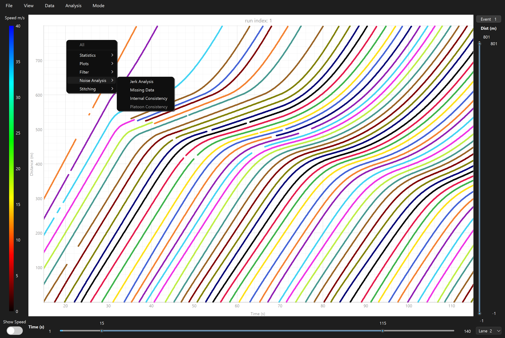

*Figure 20 Noise Analysis submenu expanded*

### Stitching

**Basic Stitching** starts [Trajectory Stitching](#14-trajectory-stitching) with the targeted trajectory as the first segment. It's enabled only when exactly one trajectory is targeted (right-click directly on it) and the plot is in Time-Space Diagram mode. **Advanced Stitching** is present but disabled — reserved for a future module.

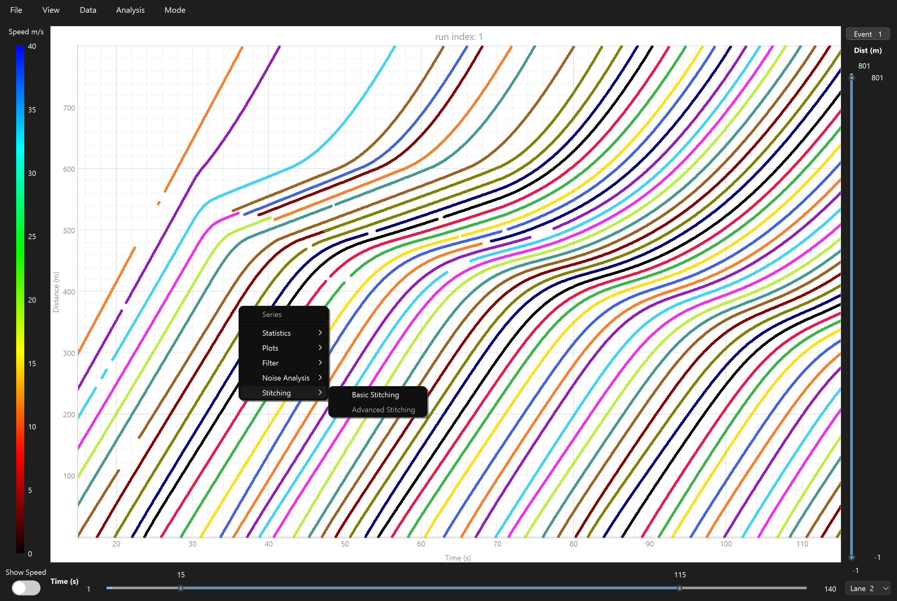

*Figure 21 Right-click menu in the "Series" context with the Stitching submenu*

---

## 9. Interaction Modes

The **Mode** menu switches how clicking and hovering on the time-space plot behaves. Only one mode is active at a time.

### 9.1 Time-Space Diagram

The default mode, covered in [§7](#7-the-time-space-plot): click to toggle a vehicle's selection, drag to box-select multiple vehicles, Shift+drag to remove them. Most other features (Statistics, Plots, Filter, Noise Analysis, and Stitching in the right-click menu; Vehicle Search) assume you're in this mode.

Trajectory Stitching temporarily replaces this mode with its own trajectory-picking mode, and returns to Time-Space Diagram when you finish or cancel; see [§14](#14-trajectory-stitching).

### 9.2 Gap Headway

Gap Headway mode overlays spacing information for individual points instead of selecting trajectories:

- **Hover** near a point to see a transient overlay showing that vehicle's **gap** (distance to the nearest vehicle ahead/behind at that instant) and **headway** (time to the nearest vehicle ahead/behind passing the same position), drawn as connecting lines with labels. The overlay disappears when you move away.
- **Click** a point to lock its overlay in place so it stays visible while you inspect others; click a locked point again to unlock it.
- Locked points persist even if you temporarily switch to another mode and back to Gap Headway.
- Press **Escape** to clear every locked point at once.

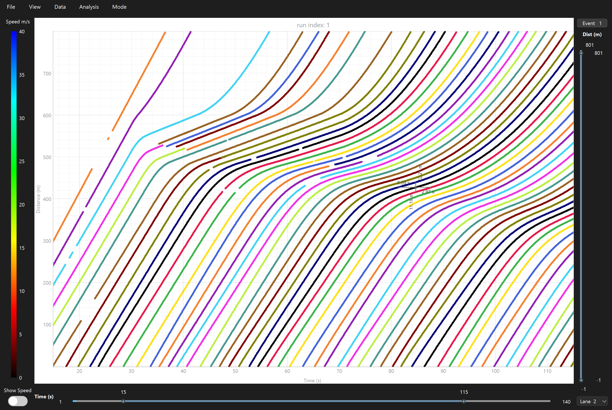

*Figure 22 Gap Headway mode with a locked overlay*

### 9.3 Shockwave

Shockwave mode identifies traffic shockwaves — lines of constant speed drawn through the points where vehicles change speed together — by having you select a chain of matching inflection points across adjacent trajectories. **Only the Semi-Automatic method is currently implemented**; Manual and Automatic appear in the configuration dialog but are disabled, reserved for future phases.

**Starting a session.** Selecting Shockwave from the Mode menu first opens a configuration dialog:

- **Generation method** — Semi-Automatic (the only enabled option).
- **Min slope change** — the percentile threshold (default 80%) used to detect candidate inflection points; also adjustable live during the session via a slider that appears beneath the plot's time slider.
- **Vicinity parameter** — reserved for Automatic mode; disabled for now.
- **Data selection** — plot against the original measured position data, or against spline-fitted position data if [Spline Fitting](#11-data-menu--spline-fitting) has already been run for this event (otherwise disabled with an explanatory tooltip).

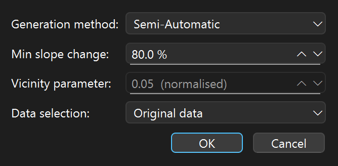

*Figure 23 Shockwave configuration dialog*

**Building a chain.** Once active, colored X markers appear on every trajectory at its detected candidate inflection points — green for a **release** point (speed increasing) and red for a **compression** point (speed decreasing). Click a marker to start a chain:

- Your first click locks the chain to that marker's color — only markers of the same type are selectable for the rest of the chain.
- Only markers on the trajectory immediately adjacent to the current front or back of your chain are selectable next (shown at full size); every other marker dims, preventing you from skipping a trajectory or picking points out of order.
- Selected points are connected by a line as you build the chain.

*Figure 24 Shockwave chain under construction*

**Committing.** Press **Enter** to fit a line through the chain (at least 2 points are required). The fit is drawn as a dashed line through the full set of trajectories with a "SW N" label, and a floating results panel appears in the plot's upper-right corner showing that shockwave's ID, equation, fitted speed, and R². Press **Escape** instead to abandon an in-progress chain without committing it.

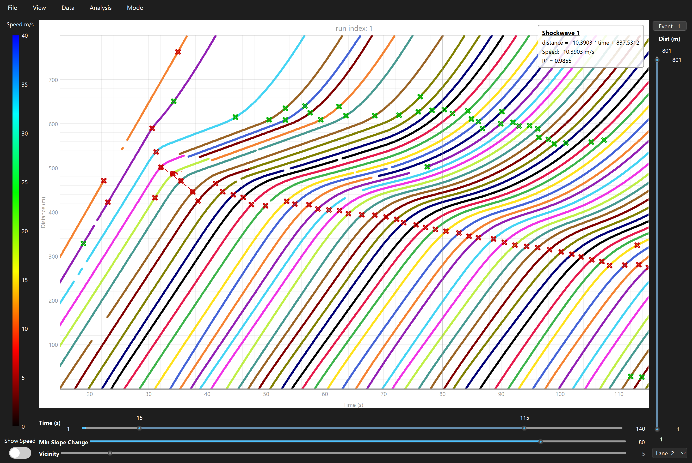

*Figure 25 Committed shockwave with the floating results panel*

**Reviewing, editing, and deleting.** Click the result panel's title to open the full results table for every shockwave committed this session, without ending the session. To revise a committed shockwave, **Ctrl+Left-click** it to reopen its points as an active chain — add or remove points and press Enter to re-fit, or Escape to revert to the original. **Ctrl+Right-click** deletes a chain point while building, or a committed shockwave while idle.

**Saving your results.** Switching out of Shockwave mode (or closing the plot) with committed results prompts you to save first. Choosing to save opens the results table with a **Save** button that writes every committed shockwave's ID, mode, equation, speed, R², and point count to a CSV file.

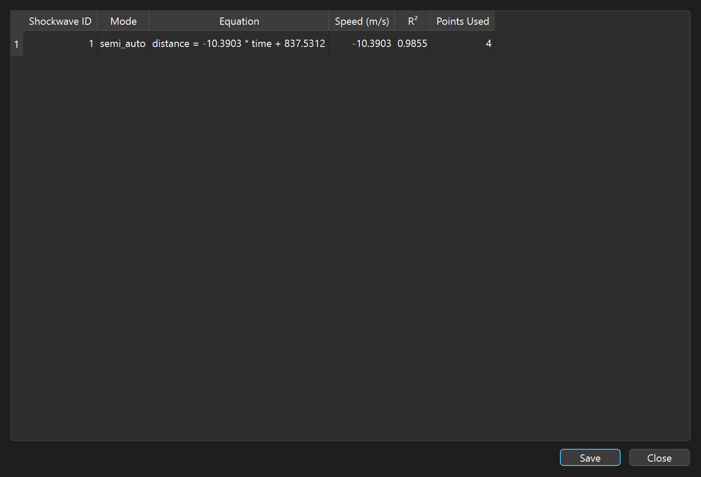

*Figure 26 Shockwave results table*

---

## 10. Changing Data: Write Targets and Row Status

Several modules change the trajectory database rather than only reading it. TRACES handles every change the same way, so you can always tell original data from corrected data, and undo a correction.

### Choosing Where Changes Are Written

The three correction modules — **Gap Interpolation**, **Lane-Level Anomalies**, and **Trajectory Stitching** — have a **Write changes to:** row with a **Browse…** button. It shows the open database by default.

- **The open database.** The first time any of these modules is about to change the open file, a **Write Changes** prompt says where the changes will be written and offers **Write to This File**, **Save to a Copy…**, or **Cancel** (the default). Once you choose Write to This File, TRACES doesn't ask again for that file until you open a database again.
- **A copy.** Choosing **Save to a Copy…** in the prompt — or entering or browsing to a different file in the Write changes to row — copies the open database to that file (asking before replacing an existing one) and switches TRACES to the copy. The plot keeps its event, lanes, and view; the window title and the Recent list show the copy; and the original file is left untouched. Any other window still reading the original (for example, a Spline Fitting preview) is closed.

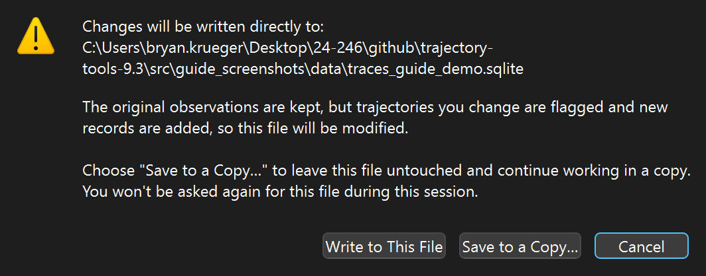

*Figure 27 Write Changes prompt on the first change to a database*

Spline Fitting and Internal Consistency write their calculated columns directly to the open database without this prompt: they add columns of results and never change the measured values.

### How Changed Rows Are Marked

The original observations are never deleted. Instead, TRACES marks each row of the `events` table with its provenance in one column, `imputed_status`, and keeps whatever a correction replaced:

| `imputed_status` | Meaning | Written by |
|---|---|---|
| (blank) | Original observation, as imported | Import |
| `S` | Synthetic row added only to complete a uniform time grid; holds calculated values but no measurement | Spline Fitting with "Fill missing rows" ([§11](#11-data-menu--spline-fitting)) |
| `A` | Missing observation filled automatically | Gap Interpolation ([§12](#12-data-menu--gap-interpolation)) |
| `M` | Missing observation filled or refined manually | Gap Interpolation ([§12](#12-data-menu--gap-interpolation)) |
| `L` | Lane reassigned; position, speed, and acceleration are still the measured values | Lane-Level Anomalies ([§13](#13-data-menu--lane-level-anomalies)) |

When a correction overwrites an existing row — a gap fill that bridges a few measured points, or a lane reassignment — the row's previous values are saved in a `superseded_points` table and put back if the correction is removed or undone. Each module also keeps its own records in a table of its own: `gaps`, `lane_anomalies` and `lane_corrections`, and `stitches`.

Trajectory Stitching works at the level of whole trajectories, so it uses a second column, `traj_status`:

| `traj_status` | Meaning |
|---|---|
| `K` | Kept — not part of a stitch (the default) |
| `R` | Removed — a segment used to create a stitched trajectory; hidden from the plot and from analyses |
| `S` | Stitched — a trajectory created by combining segments |

Both columns appear in exports ([§17](#17-exporting-data)), so the provenance of every exported row is visible.

### How Other Features Treat Corrected Rows

- Synthetic Spline Fitting rows (`S`) carry no measurement, so the time-space plot, Missing Data, Internal Consistency, Advanced Statistics, Trajectory Stitching, Gap Interpolation, and Lane-Level Anomalies ignore them as trajectory data. (Shockwave mode plots them when you choose spline-fitted data, since that is the point of that option.)
- Gap fills (`A`, `M`) and lane corrections (`L`) are treated as part of the trajectory everywhere — in the plot, in analyses, and in exports. In particular, Missing Data analysis no longer reports a gap once it has been filled.
- Removed trajectories (`traj_status` `R`) are hidden from the plot and from every analysis.

---

## 11. Data Menu — Spline Fitting

Spline fitting fits a smooth curve to one kinematic quantity of a trajectory — position, speed, acceleration, or jerk — then derives the other three from that single curve mathematically. It's useful for smoothing noisy measurements and, optionally, filling small timing gaps. TRACES has two separate entry points for this, serving different purposes:

| | **Data → Spline Fitting** | **Right-click → Filter → Spline Fitting** |
|---|---|---|
| Scope | One or more whole events | Exactly one trajectory |
| Writes to the database | **Yes** — adds/updates `calc_*` columns | **No** — preview only |
| Gap filling | Optional, via a checkbox | Not available |
| Output | A goodness-of-fit statistics table (exportable to CSV) | An interactive HTML export of the four kinematic plots |
| How to open it | Data menu | Right-click on the plot (see [§8](#8-right-click-menu-on-the-plot)) |

For filling missing observations with reviewable, per-gap control, use [Gap Interpolation](#12-data-menu--gap-interpolation) instead; it uses the same spline fitting for each gap.

### 11.1 Data → Spline Fitting

This is the entry point that actually modifies your database. It has two steps:

**Step 1 — choose events.** A multi-select list (also used by File → Export → Export Analysis, [§17](#17-exporting-data)) shows every event in the database by ID and name, with **Select All** / **Clear** helpers. At least one event must be selected to continue.

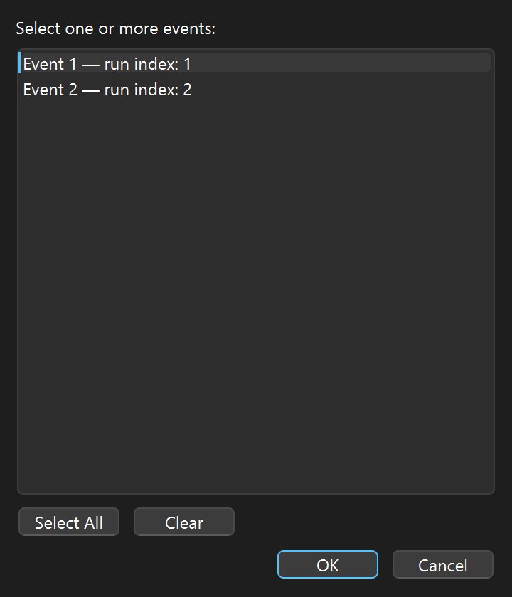

*Figure 28 Event selection list*

**Step 2 — set parameters.** The Spline Fitting dialog offers:

- **Fitting base** — Position (Distance Traveled), Speed, Acceleration, or Jerk. Only bases whose source column (`veh_dist_trav`, `veh_speed`, `veh_accel`, `veh_jerk`) exists in your dataset are selectable; Position is always available since `veh_dist_trav` is required for every import.
- **Smoothness level (s)** — higher values produce a smoother, less exact fit; default 1.0.
- **Spline degree (k)** — the available degrees depend on the chosen fitting base (only odd degrees are offered).
- **Fill missing rows (resample at uniform timestep)** — when checked, also inserts new rows at a uniform timestep to fill timing gaps in the data, populated only with calculated values (measured columns are left blank on these synthetic rows, since there's no actual measurement).

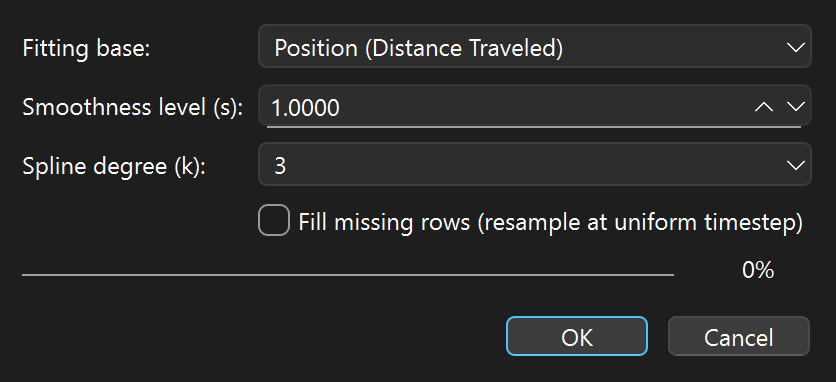

*Figure 29 Spline Fitting parameter dialog*

Clicking **OK** runs the fit across every selected event on a background thread, with a progress bar. When it finishes, it writes four columns to the events table — `calc_position`, `calc_speed`, `calc_acceleration`, `calc_jerk`. Rows added by "Fill missing rows" are marked `S` in the `imputed_status` column ([§10](#10-changing-data-write-targets-and-row-status)), which distinguishes them from existing rows that simply received a calculated value. These columns are added automatically the first time you run Spline Fitting and are then available everywhere else in the application (other analyses, plots, and exports) like any other column.

A **Spline Fit Statistics** window then opens: a per-trajectory table of goodness-of-fit metrics (RMSE, MAE, max/min/mean error for each of the four kinematics, plus point and imputed-row counts) with its own **Save…** button to export the table to CSV. This is the only CSV export path specific to Spline Fitting — there's no separate Export Analysis entry for it, since the `calc_*` columns themselves are already available through the ordinary [Export All / Export Selected](#17-exporting-data) paths once they exist.

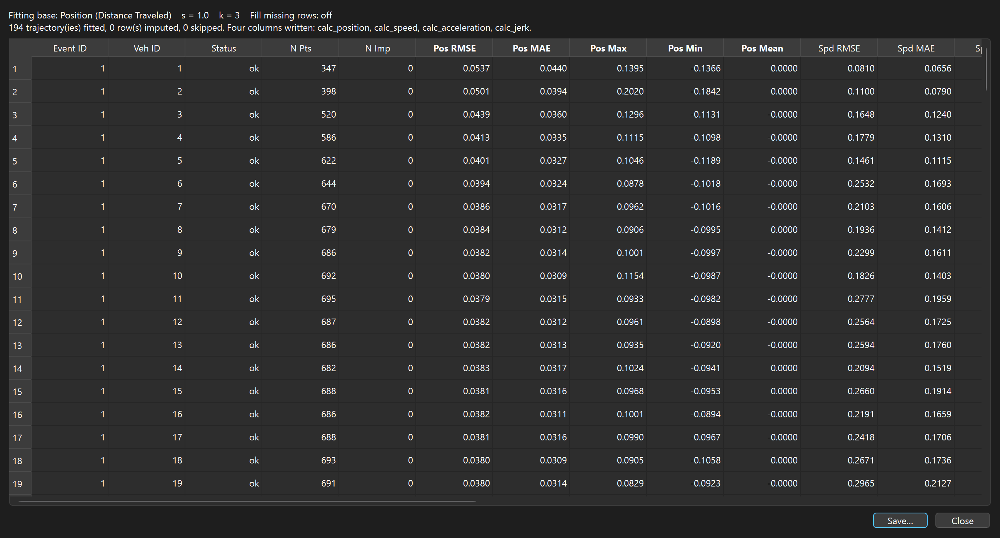

*Figure 30 Spline Fit Statistics results table*

### 11.2 Right-Click → Filter → Spline Fitting

This entry point is for trying out fitting parameters against a single trajectory before committing to anything — nothing here is ever written to the database. It opens for exactly one vehicle (see the single-trajectory restriction in [§8](#8-right-click-menu-on-the-plot)) and shows Position, Speed, Acceleration, and Jerk as a [kinematic stacked plot](#kinematic-stacked-plots), each plotting the measured data against time. Press **1** to view one plot at a time, **0** to see all four.

Choose a fitting base, smoothness, and degree, then click **Update Plot** — nothing recalculates automatically as you adjust the controls. The fit is overlaid on all four plots at once; the plot for the base actually used gets a leading "*" on its axis label (e.g. "*Speed (m/s)"), and each plot's title shows that kinematic's own goodness-of-fit readout. Fitting bases without enough valid points on this trajectory are disabled, with a tooltip explaining why. Clicking **Original Data** or **Spline Fit** in any legend hides or shows that series on all four plots.

**Save Plots** exports all four plots to a self-contained interactive HTML file ([§3](#saving-plots-as-interactive-html)).

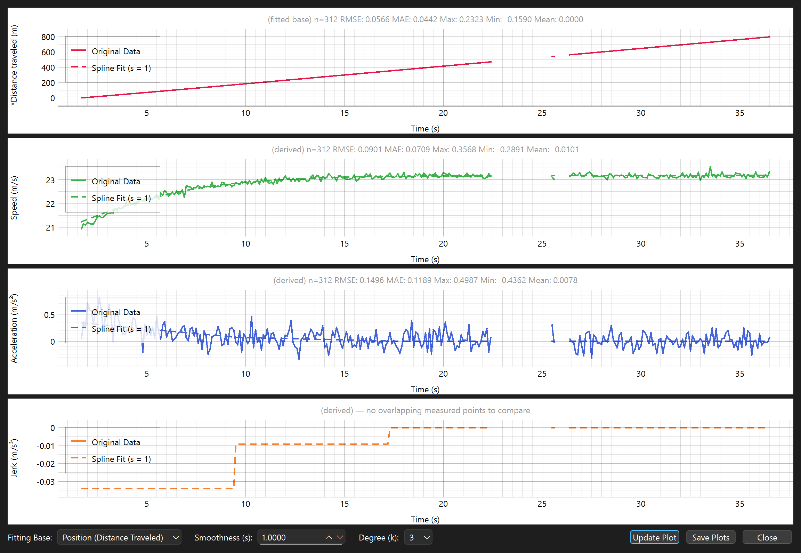

*Figure 31 Right-click Spline Fitting preview dialog*

---

## 12. Data Menu — Gap Interpolation

Gap Interpolation detects missing or discontinuous observations within the trajectories of the currently plotted event, fills them using spline interpolation, and lets you review and refine each fill. Filled rows are added to the events table without overwriting the original observations, so the corrected trajectory can always be traced back to the measured data ([§10](#10-changing-data-write-targets-and-row-status)).

Choose **Data → Gap Interpolation** to start. It always works on the entire event currently plotted. You first set defaults in a configuration window, then refine individual gaps in a review window.

### 12.1 The Configuration Window

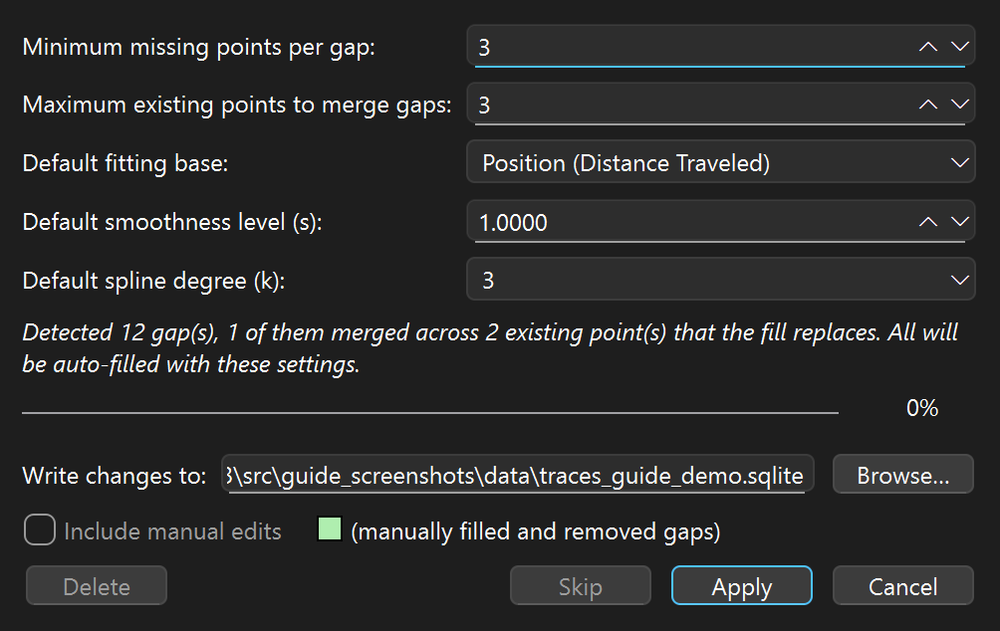

*Figure 32 Gap Interpolation configuration dialog*

**Gap definition.** Two settings decide what counts as a gap:

- **Minimum missing points per gap** (default 3) — a run of consecutive missing samples is a gap only if it has at least this many. Shorter runs are left as they are.
- **Maximum existing points to merge gaps** (default 3) — two gaps separated by at most this many measured points are merged into one gap. The points in between still shape the spline fit, but the fill replaces their values; the measured values are kept and come back if the fill is removed or deleted. 0 never merges.

The expected sampling interval is the event's most common time step. Changing either setting re-runs detection immediately and updates the status line with the number of gaps found; nothing is written until you click Apply.

**Default spline parameters.** **Default fitting base**, **Default smoothness level (s)**, and **Default spline degree (k)** — the same choices as [Spline Fitting](#11-data-menu--spline-fitting) — are used to fill every gap automatically.

**Include manual edits.** Gaps you have filled or removed by hand in the review window are protected by default:

- **Unchecked** (the default each time the window opens): Apply refills only automatically filled and unfilled gaps, and Delete deletes only those.
- **Checked**: Apply replaces every gap's fill — you're asked to confirm before manual changes are lost — and Delete deletes every gap record.

The color swatch next to the checkbox is the color manually filled gaps have in the review window.

**Buttons.**

- **Apply** detects every gap in every trajectory of the event, fits a spline to each trajectory with the default parameters, and fills each gap at the expected timestamps. Each filled row is marked "interpolated automatically" (`A`), and each gap is recorded, with its spline parameters, in a `gaps` table in the database. The review window then opens.
- **Skip** opens the review window on the gaps already recorded for this event, without re-running detection and fill.
- **Delete** deletes the event's gap records together with their filled rows, following "Include manual edits." Measured points that a fill had replaced get their measured values back. Deleted gaps are found and filled again by the next Apply.
- **Cancel** closes the window.

Apply, Skip, and Delete all use the **Write changes to** target ([§10](#10-changing-data-write-targets-and-row-status)).

### 12.2 The Gap Review Window

The review window shows one trajectory at a time as a [kinematic stacked plot](#kinematic-stacked-plots) of distance traveled, speed, and acceleration. Each gap of that trajectory is shaded on all three plots and labeled with its gap number, and the selected gap has a black border.

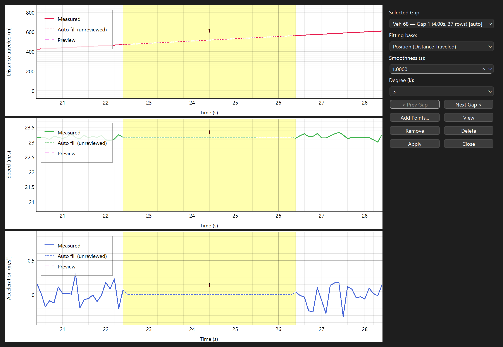

*Figure 33 Gap Review window with an automatically filled gap selected*

**Gap colors.**

| Background | Gap status |
|---|---|
| White | Original data (no gap) |
| Yellow | Interpolated automatically; the fill is drawn as a short-dashed line until you review it |
| Green | Interpolated manually; the fill is solid, as part of the trajectory |
| Light red | Detected but not filled (the fill was not attempted or failed) |
| Grey | Fill removed on purpose; the trajectory breaks across it |

**Choosing a gap.** The **Selected Gap** list holds every gap of the event, sorted from the largest gap to the smallest, each shown as vehicle, gap number, duration, missing rows, and status. Choose one from the list or step through them with **< Prev Gap** and **Next Gap >**; a gap on another vehicle loads that vehicle's plots. Selecting a gap zooms the time axis so the gap fills the middle half of the plots, and loads the spline parameters last saved for it. Selecting never changes any values.

**Refining a gap.** For the selected gap, choose its **Fitting base** (distance, speed, or acceleration), **Smoothness (s)**, and **Degree (k)**, then:

- **View** previews the fill with these parameters as a purple dashed line. Nothing is saved.
- **Apply** saves the fill with these parameters. The gap becomes "interpolated manually" (`M`): its background turns green and its line solid. Its parameters are saved in the gaps table, so they are loaded again whenever you return to this gap.
- **Remove** deletes the gap's filled rows but keeps the gap record, marked removed (grey). Automatic reruns leave it unfilled unless "Include manual edits" is checked; you can still fill it here with Apply.
- **Delete** deletes the gap record and its filled rows, so the next automatic run finds and fills it as a new gap. The next gap is then selected.

Remove and Delete ask for confirmation.

*Figure 34 Gap Review window previewing new spline parameters with View*

**Adding points.** **Add Points...** lets you place extra points inside the gap to guide the spline, which treats them as additional data. The plots are enlarged to the fitting-base plot and the plot derived from it (distance with speed, or speed with acceleration), so you see the effect on the derived quantity as you work; points can be added only on the fitting-base plot.

- **Click** inside the gap to add a point.
- **Ctrl+Click** a point to remove it.
- **Drag** a point to move it.
- **Enter** keeps the points and returns to the normal view.
- **Escape** discards the changes made in this session and returns to the normal view.

The dashed preview updates after every change. Click **Apply** afterwards to save a fill that uses the points.

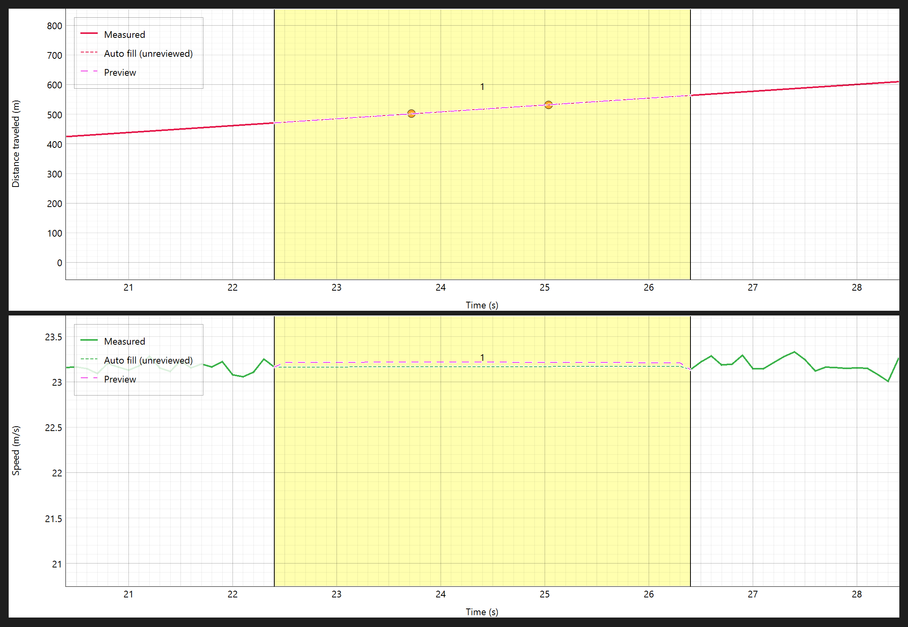

*Figure 35 Gap Review window in Add Points mode*

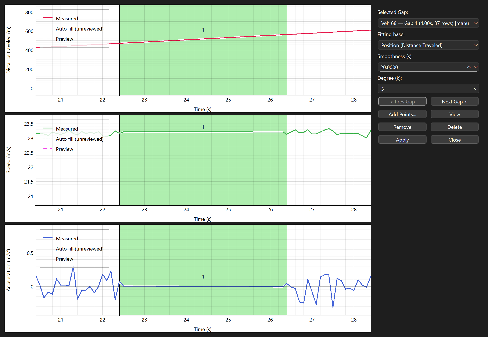

*Figure 36 Gap Review window after Apply: the gap is manually filled*

**Closing.** **Close** ends the review. If anything changed, the time-space plot reloads so the fills appear immediately.

The gaps table holds, for each gap: the trajectory ID, a gap ID, the start time (the timestamp immediately before the gap), the end time (the timestamp immediately after it), the duration, the number of missing rows, the spline parameters, and the status. There's no separate CSV export for gaps: the filled rows and their `imputed_status` are exported with [Export All / Export Selected](#17-exporting-data).

---

## 13. Data Menu — Lane-Level Anomalies

The Lane-Level Anomaly module identifies physically implausible lane assignments in the event currently plotted, presents them for review one at a time, and lets you correct them. Choose **Data → Lane-Level Anomalies** to start.

Two anomaly types are built in:

- **Proximity** — two vehicles in the same lane closer than a threshold, measured center to center (the difference in distance traveled at the same moment). This often means one of them was assigned to the wrong lane.
- **Rapid Lane Change** — a vehicle repeatedly and rapidly assigned back and forth between two neighboring lanes, which indicates a likely lane-assignment error rather than real vehicle behavior.

> **How this module differs from its specification.** Customer review found that a lane-level correction is always an update to a vehicle's lane. The module therefore has no separate fix window for each anomaly type, and no spline-fitted midline trajectory for rapid lane changes. Every anomaly is fixed in the same **fix panel** on the review window, by reassigning the lane of one or more vehicles over a time segment. Positions, speeds, and accelerations are never changed. For Proximity, the fix panel is always available, without first asking whether a lane assignment error is suspected.

### 13.1 Selecting Anomalies to Identify

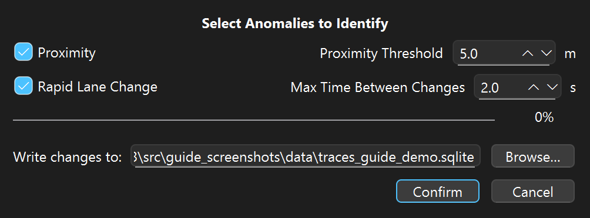

*Figure 37 Select Anomalies to Identify dialog*

Check each anomaly type to look for and set its parameter:

- **Proximity Threshold** (m, default 5.0) — vehicles in the same lane closer than this are reported.
- **Max Time Between Changes** (s, default 2.0) — a vehicle switching back and forth between two neighboring lanes at least three times, with no more than this long between consecutive switches, is reported.

Click **Confirm** to analyze every trajectory of the event (the button is disabled while no type is checked); the review panel then opens. Detection results are stored in the database, using the **Write changes to** target ([§10](#10-changing-data-write-targets-and-row-status)). Running detection again replaces the unfixed anomalies of the checked types and keeps the ones you've fixed; types you leave unchecked keep their previous results.

### 13.2 Reviewing and Fixing Anomalies

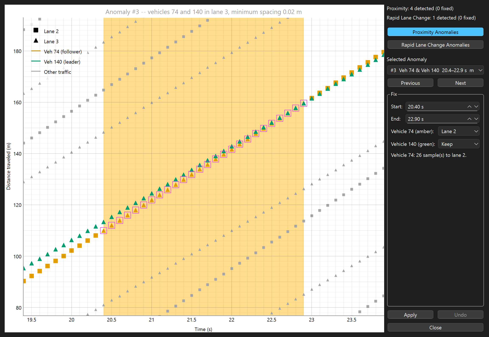

*Figure 38 Lane-Level Anomalies review panel: a Proximity anomaly with a fix set up*

**The plot.** The left side is a time-space diagram of the selected anomaly, framed on the anomaly's time span, which is shaded light red (green once fixed). Colors identify vehicles — the anomaly's first vehicle amber, the second green, other traffic grey — and symbols identify lanes (circle, square, triangle, and so on). The legend lists each lane's symbol and each vehicle's color; click an entry to hide or show its points, and hover over a point to see its vehicle, time, lane, and distance. Other traffic is drawn for the lanes involved, so you can see where a vehicle actually fits.

**The panel.** The right side, from top to bottom:

- one line per anomaly type: **N detected (M fixed)**,
- a button per type — **Proximity Anomalies**, **Rapid Lane Change Anomalies** — that switches the panel to that type,
- **Selected Anomaly**, a list of the type's anomalies, each with its ID, vehicles, time span, and lanes (fixed ones marked `[fixed]`), with **Previous** and **Next**,
- the **Fix** panel for the selected anomaly,
- **Apply**, **Undo**, and **Close**.

**Setting up a fix.** Every fix reassigns the lane of one or more vehicles over a time segment:

- **Start** and **End** set the segment; they default to the anomaly's span and snap to the vehicles' samples.
- For a **Proximity** anomaly, each vehicle — the follower (amber) and the leader (green) — has a **Move to** choice, **Keep** by default, offering every lane of the event. Moving either or both vehicles is one fix.
- For a **Rapid Lane Change** anomaly, choose the lane to put the vehicle in for the segment: one of the anomaly's two lanes, each shown with its sample count in the segment (the lane holding more samples is preselected), or **Other lane:** with any other lane of the event.

The plot previews the fix as you set it up: the segment is shaded yellow and each sample that would move is ringed in magenta with its new lane's symbol. A summary line says what Apply will change.

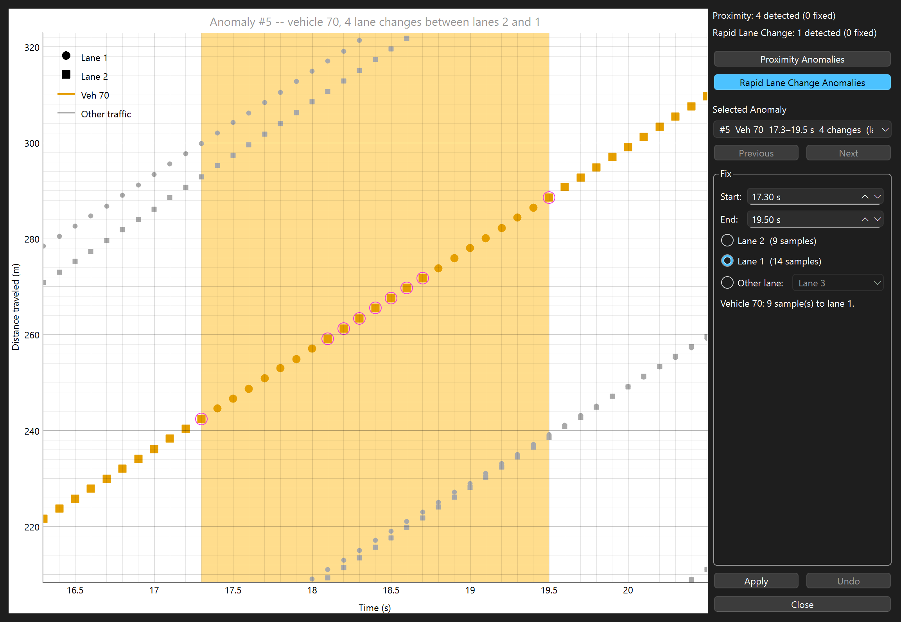

*Figure 39 Lane-Level Anomalies review panel: a Rapid Lane Change anomaly with a fix set up*

**Applying and undoing.** **Apply** writes the fix: the moved rows get their new lane and the `L` status ([§10](#10-changing-data-write-targets-and-row-status)), the previous lanes are saved, the anomaly is marked fixed, and the fix panel shows the fix in effect. **Undo** (after confirmation) gives every vehicle the fix moved its previous lanes back and returns the anomaly to detected. Because kinematics are never changed, spline fits and internal consistency results computed before a fix remain valid.

A fix is refused, with a message saying what to undo first, if part of the segment:

- is gap-filled — remove or delete those fills in [Gap Interpolation](#12-data-menu--gap-interpolation) first, or
- was already corrected by another anomaly's fix — undo that fix first.

Anomalies on trajectories used in a stitch are hidden. Choosing another anomaly or type, or closing the panel, discards fix choices you haven't applied. When the panel closes after an Apply or Undo, the time-space plot reloads.

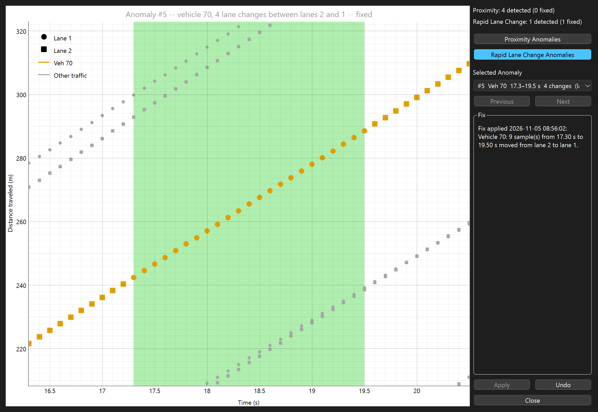

*Figure 40 Lane-Level Anomalies review panel after Apply*

The anomalies and every fix are recorded in the `lane_anomalies` and `lane_corrections` tables, so detected, reviewed, and corrected records can be traced. The module is built so that more anomaly types, with fixes of their own, can be added later.

---

## 14. Trajectory Stitching

Trajectory processing sometimes assigns two different vehicle IDs to segments that belong to the same real vehicle. Trajectory Stitching lets you pick two such segments, check whether they fit together, preview the combined trajectory, and create it under a new vehicle ID. The original segments are kept, marked removed, and can be restored with Undo.

### 14.1 Picking the Trajectories

Right-click one of the segments and choose **Stitching → Basic Stitching** ([§8](#8-right-click-menu-on-the-plot)). The plot enters a trajectory-picking mode: the chosen trajectory gets an orange halo along its whole length — across every lane, since segments often break at a lane change — and a banner at the top of the plot reads **"Select trajectory to stitch."**

- **Click** another trajectory to pick it as the second segment; it gets a halo too. Clicking a third trajectory replaces the older pick. You can change lanes while picking.
- **Enter** opens the stitching preview for the two picked trajectories.
- **Escape** drops the most recent pick; dropping the only pick leaves the mode.
- **Right-click**, or **Mode → Time-Space Diagram**, leaves the mode.

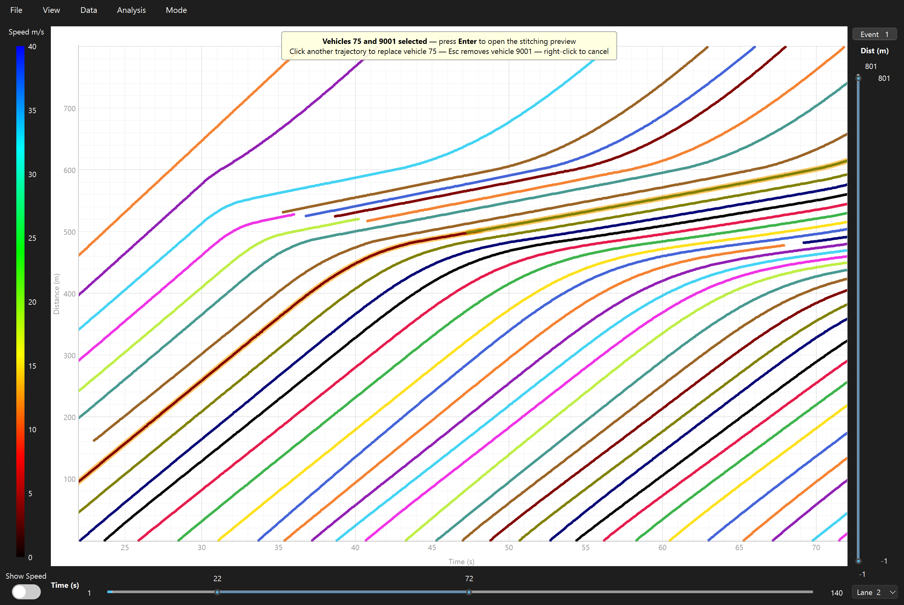

*Figure 41 Trajectory stitching selection with two trajectories picked*

### 14.2 The Stitching Preview

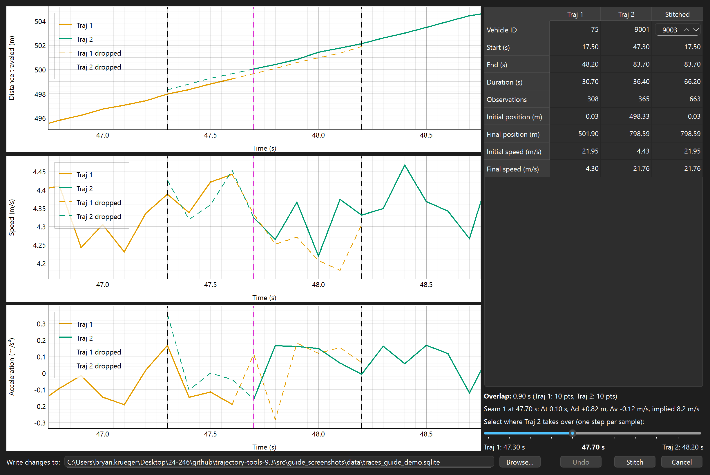

*Figure 42 Trajectory Stitching preview for an overlapping pair*

The preview names the two segments **Traj 1** and **Traj 2** in chronological order, whichever you clicked first.

**Plots.** The left side is a [kinematic stacked plot](#kinematic-stacked-plots) of distance traveled, speed, and acceleration. Traj 1 is amber and Traj 2 green on every plot: solid where the stitched trajectory keeps the samples, dashed where it drops them. Click legend entries to show or hide Traj 1, Traj 2, and the stitched trajectory.

**Information.** The right side shows a table with a column each for Traj 1, Traj 2, and the Stitched trajectory, giving the vehicle ID, start and end time, duration, number of observations, initial and final position, and initial and final speed. Below it, the relationship between the two segments and a summary of each seam (the time step, distance change, and speed change where the two meet).

**New vehicle ID.** The stitched trajectory's vehicle ID is proposed in the table — one more than the largest ID the event has ever used, so an ID is never reused — and can be edited. An ID already used in the event isn't accepted.

**How the segments are combined.** TRACES compares the end of Traj 1 with the start of Traj 2 using the event's sampling interval:

| Relationship | When | Stitched trajectory |
|---|---|---|
| **Gap** | at least one expected sample is missing between Traj 1's end and Traj 2's start | every observation of both; a dark blue dashed **stitch line** shows the span with no observations |
| **Continuous** | Traj 2 starts at the next expected sample after Traj 1 ends | every observation of both |
| **Overlap** | Traj 2 starts before Traj 1 ends | Traj 1 before the split point and Traj 2 from the split point on |

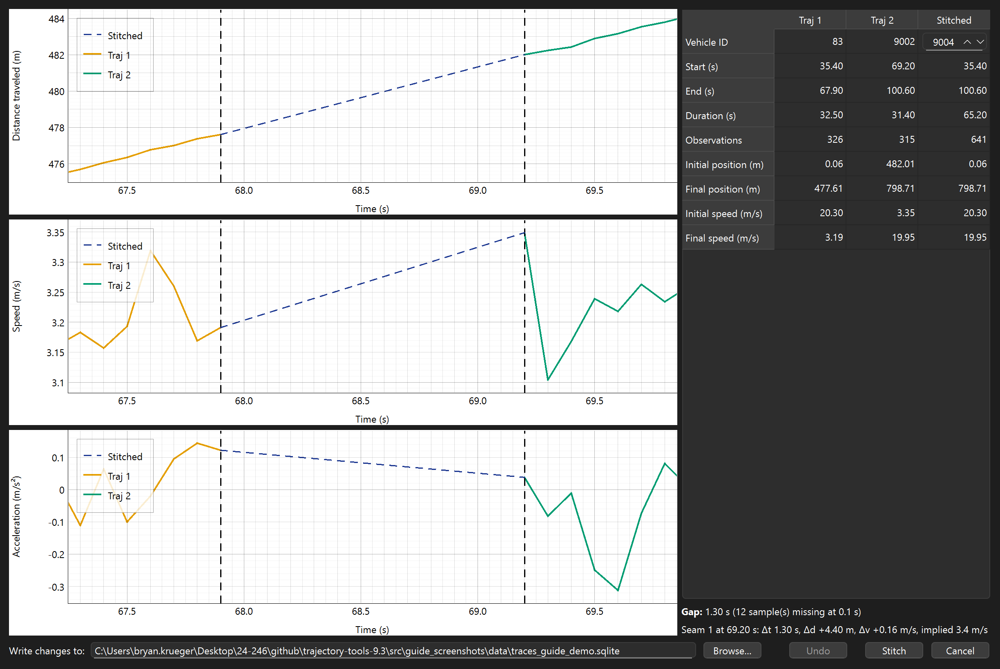

*Figure 43 Trajectory Stitching preview for a pair separated by a gap*

**Overlap split.** For an overlapping pair, a slider — **Select where Traj 2 takes over (one step per sample)** — sets the split point, shown as a purple dashed line on every plot. It starts in the middle of the overlap and steps through Traj 2's samples, so the split always falls on a real observation; the last position keeps all of Traj 1's overlap. The overlap boundaries are drawn as black dashed lines. If Traj 2 lies entirely within Traj 1's time span, Traj 1 also supplies the samples after Traj 2 ends.

**Safety checks.** Some pairs probably shouldn't be stitched. When a check fails, a red warning appears on the window itself. Warnings don't block stitching — they ask you to look again.

- **"The selected Trajectories Should Not Be Selected Together"** — for overlapping pairs only: a segment has more points in the overlap than outside it, and the nearest points of the two segments within a 1-second span are more than 5 m apart.
- **"Trajectories That Skip A Lane Should Not Be Stitched"** — the stitched trajectory would jump over a lane where it passes from one segment to the other.

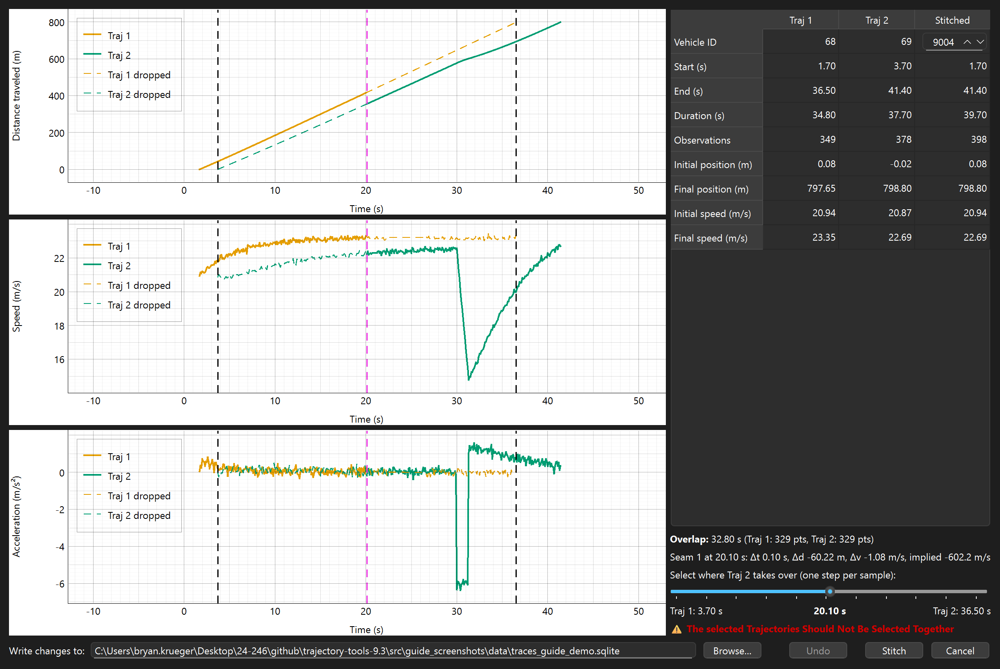

*Figure 44 Trajectory Stitching preview showing a safety warning*

**Stitching.** The bottom of the window has the **Write changes to** row ([§10](#10-changing-data-write-targets-and-row-status)) and the **Undo**, **Cancel**, and **Stitch** buttons. **Stitch** creates the new trajectory:

- the stitched trajectory gets status **stitched** (`S`),
- both original segments get status **removed** (`R`) — their observations are not deleted or changed,
- every other trajectory keeps status **kept** (`K`).

Removed trajectories are hidden from the plot and from every analysis, and the plot refreshes to show the stitched trajectory, selected, without changing your view. Per-row analysis results (such as spline fits and internal consistency columns) are left blank on the stitched trajectory, because values computed on separate segments aren't valid across the seam; run those analyses again on the stitched trajectory. Every stitch is recorded in a `stitches` table.

**Cancel** returns to picking with the same two trajectories, so you can swap one and try again.

### 14.3 Reviewing and Undoing a Stitch

To review a stitch, start Basic Stitching on the stitched trajectory and press **Enter** without picking a second trajectory (the banner says when this is possible). The preview opens showing the stitch as it was made, with the ID and split locked and **Undo** enabled. **Undo**, after confirmation, deletes the stitched trajectory — including any analysis results computed on it — and makes the original segments active again. The preview then lets you stitch them again with different settings, under a new ID.

---

## 15. Analysis Menu — Jerk, Missing Data, Internal Consistency, Platoon Consistency, and Spectral Analysis

Jerk Analysis, Missing Data, and Internal Consistency — found under **Analysis → Noise** — share a common structure: a parameter dialog, a background computation with a progress bar, and a results view whose contents and arrangement depend on how you launched it.

### 15.1 The Shared Pattern

| Launched from | Button | Scope | Result |
|---|---|---|---|
| **Analysis → Noise** (top-level) | OK | Every vehicle in the currently plotted event | A box-plot summary (Jerk, Missing Data) or statistics table (Internal Consistency) |
| **Right-click → Noise Analysis** ([§8](#8-right-click-menu-on-the-plot)) | OK | Only the right-click context's vehicles — clicked, selected, or all-in-lane | A plain results table (Jerk, Missing Data) or a combined plot-and-table dialog (Internal Consistency) |
| **File → Export → Export Analysis** ([§17](#17-exporting-data)) | Save | Every vehicle in each event you choose from the event selection list ([§11.1](#111-data--spline-fitting)) | Written straight to a CSV file — no results dialog shown |

All three run their computation on a background thread so the dialog stays responsive while the progress bar advances. Removed (stitched-away) trajectories are left out, and gap fills and lane corrections are included as part of their trajectories ([§10](#10-changing-data-write-targets-and-row-status)).

**Box plots.** The Jerk and Missing Data box plots, and the Advanced Statistics box plots ([§16](#16-advanced-statistics)), share one window: a grid with one box plot per metric. Hovering over a box shows its statistics (quartiles, median, and whiskers, which reach the furthest values within 1.5 times the interquartile range); values beyond the whiskers are drawn as outliers and labeled with the vehicle they came from on hover. **Save** writes the grid as an interactive HTML page ([§3](#saving-plots-as-interactive-html)).

### 15.2 Jerk Analysis

**Parameters:**

- **Jerk threshold** (m/s³, default 15) — the magnitude above which a jerk sample counts as a "violation."
- **Missing value gap threshold** (seconds, default 1.0) — the largest time gap between consecutive records that's still bridged when deriving a value; larger gaps are left blank rather than interpolated across.
- **Jerk calculation method** — use the `veh_jerk` column directly, calculate jerk from acceleration, calculate acceleration and jerk from speed, or use jerk from spline-fit results. Only methods whose source column exists in your dataset are selectable.

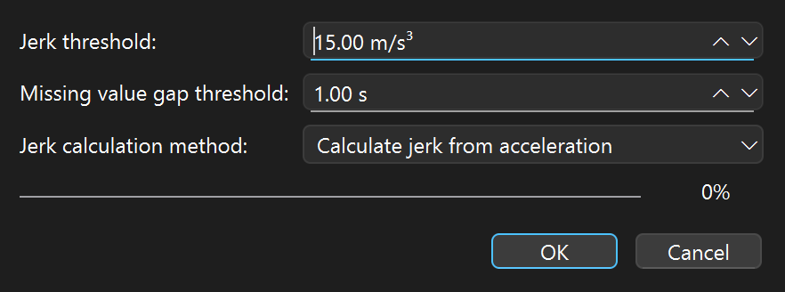

*Figure 45 Jerk Analysis parameter dialog*

**Output per vehicle:** minimum, mean, and maximum jerk; the percentage of samples exceeding the jerk threshold; and a sign-inversion excess percentage (how often jerk oscillates in sign more than once within a one-second window — a rough smoothness/noise indicator).

- **Top-level:** box plots of all five metrics across every vehicle in the event, with a count of vehicles dropped for having no jerk data available under the chosen method.
- **Right-click:** a plain table of the same metrics for just the target vehicle(s).

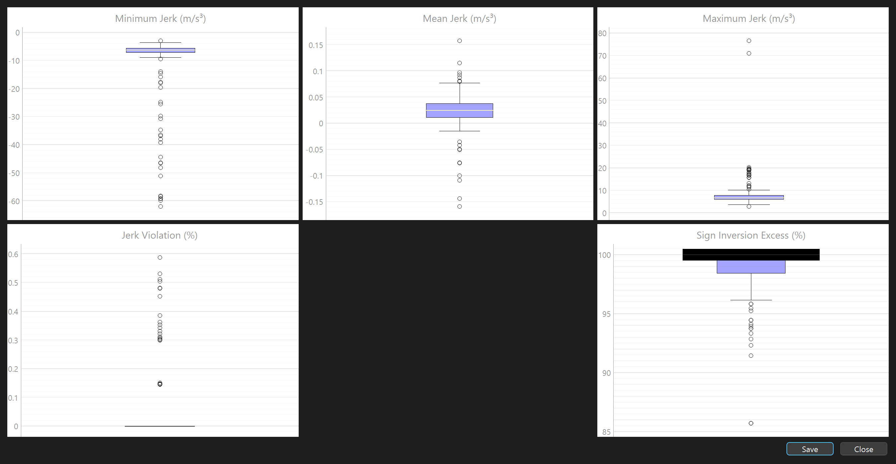

*Figure 46 Jerk Analysis box plot results*

### 15.3 Missing Data

**Parameters:**

- **Missing value gap threshold** (points, default 10) — the number of consecutive missing records required before a stretch counts as a reportable "gap."
- **Time step** — leave **Auto-calculate Dataset Time Increment** checked to let TRACES infer the expected sampling interval from the data itself (the most common time step across the dataset), or uncheck it to enter a manual increment.

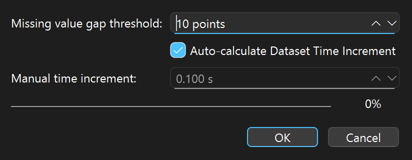

*Figure 47 Missing Data parameter dialog*

**Output per vehicle:** the percentage of missing records, the number of gaps at or above the threshold, and the length of every individual gap.

- **Top-level:** box plots of missing-record percentage, gap count, and gap length across the whole event.
- **Right-click:** a plain table of the same per-vehicle metrics for the target vehicle(s).

This analysis only reports missing data; to fill it, use [Gap Interpolation](#12-data-menu--gap-interpolation). Rows synthesized by Spline Fitting's "Fill missing rows" option ([§11](#11-data-menu--spline-fitting)) are excluded from this analysis — counting a synthetic fill row as "present" would hide the very gap this module exists to find. Gaps filled by Gap Interpolation, on the other hand, count as data and are no longer reported.

### 15.4 Internal Consistency

This analysis checks whether a trajectory's measured kinematics agree with what its own position data implies: it differentiates position to calculate speed, acceleration, and jerk, then compares each calculated value against the corresponding measured column (where present).

**Parameters:**

- **Dataset time increment** (seconds, default 0.1) and **Missing value gap threshold** (points, default 10) — together they define how large a timing gap is tolerated before a comparison is skipped across it, rather than computed.

Requires the `veh_dist_trav` column, which is always present since it's required for every import.

- **Top-level:** writes six calculated columns to the database (calculated speed, acceleration, and jerk, plus each one's error from the measured value), then opens a statistics summary table.
- **Right-click:** opens a combined results window: on the left, a [kinematic stacked plot](#kinematic-stacked-plots) of speed, acceleration, and jerk, each with the measured value solid and the calculated value dashed in the same color; on the right, a statistics summary for the current trajectory above a scrollable raw data table. Clicking a raw-data row places the plot cursor at that row's time. **← Prev**, **Next →**, and the trajectory dropdown move between vehicles, and **Save Plots** exports the plots to interactive HTML. Clicking **Measured** or **Calculated** in any legend shows or hides it on all three plots. This path also writes the same six columns to the database.
- **Export** (File → Export → Export Analysis): streams results straight to CSV across every selected event without writing anything to the database.

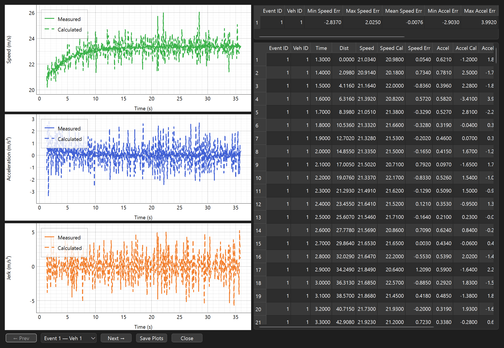

*Figure 48 Internal Consistency combined results dialog*

### 15.5 Platoon Consistency

This analysis checks whether the spacing between a leader and follower agrees with their recorded speeds: it reconstructs spacing from the difference between the two speeds, then compares that reconstructed value against the observed spacing. It also identifies unphysically small spacing and counts vehicle pair ID flips — cases where the same two vehicles exchange leader and follower roles over time.

**Parameters:**

- **Unphysical spacing threshold** (meters, default 5) — a continuous leader–follower segment counts as unphysical if any observed spacing is strictly below this value.
- **Leader search distance threshold** (meters, default 50) — the maximum distance ahead to search for a leader in the same lane at the same timestamp. If your data already supplies a preceding vehicle ID and spacing, those values take priority and aren't limited by this search distance.

Uses `veh_dist_trav` and `lane_id` to find leaders when no valid supplied assignment is available. The `veh_speed` column is needed for spacing-bias calculations; missing speeds leave spacing metrics available but limit how much of a segment can be compared.

- **Top-level** (Analysis → Noise → Platoon Consistency): analyzes every follower in the currently plotted event on a background thread, then opens a results table. Each row is one continuous leader–follower segment, with its time range, sample count, minimum spacing, and minimum/maximum/mean bias, RMSE bias, and RMSPE bias. The summary above the table shows ID flips and the number and percentage of segments with unphysical spacing.
- **Right-click:** opens the same results table for the context's vehicles as followers. Leaders can still be any vehicle in the event, including vehicles outside your selection.
- **Export** (File → Export → Export Analysis → Platoon Consistency): writes a selection summary followed by the segment table straight to CSV across every selected event. The results dialog's **Save CSV…** button saves the displayed results in the same format.

Bias is reconstructed spacing minus observed spacing. **RMSPE is a ratio** — 0.1 means 10%, not 0.1%. **N/A** means a metric couldn't be calculated; **Valid bias samples** shows how many observations contributed to the bias statistics. None of these paths writes anything to the database.

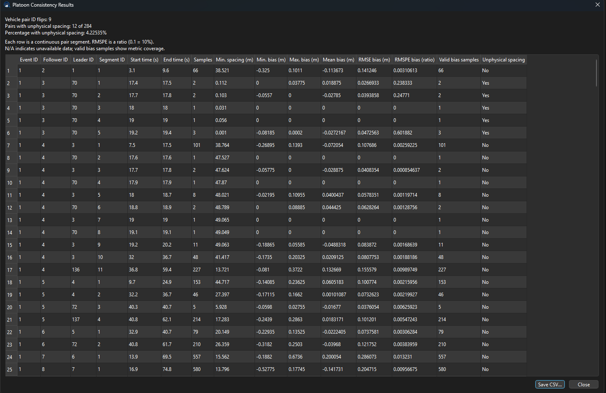

*Figure 49 Platoon Consistency results table*

### 15.6 Spectral Analysis

This analysis shows how a trajectory's speed or acceleration varies across frequencies: it transforms the recorded signal into a frequency spectrum, letting you inspect slow variations and faster oscillations separately. Each vehicle has its own spectrum and a table of the underlying Fourier coefficients and magnitudes.

**Parameters:**

- **Selected signal** — Speed (`veh_speed`, the default when available) or Acceleration (`veh_accel`). Only columns present in your dataset are selectable; if neither exists, the analysis can't be run.

Requires at least two finite samples and a positive sampling interval for each trajectory. Missing signal values are omitted, and trajectories without enough usable data are skipped. Timing gaps and irregular samples use a mean time increment without interpolation, so their frequency axes should be treated as approximate.

- **Top-level** (Analysis → Noise → Spectral Analysis): analyzes every vehicle in the currently plotted event on a background thread, regardless of lane or selection, then opens a combined spectrum-and-table dialog. Use the trajectory dropdown or **Previous** / **Next** buttons to move between vehicles; both tabs update together.
- **Right-click:** not available — launch this analysis from the top-level Analysis menu.
- **Export** (File → Export → Export Analysis → Spectral Analysis): writes every frequency bin for every analyzable vehicle across the selected events straight to CSV, including event ID, vehicle ID, frequency index, frequency, Fourier coefficient, and magnitude. None of these paths writes anything to the database.

The **Spectrum** dropdown switches the plot between **Magnitude** (the default, raw Fourier magnitude), **Amplitude** (the size of each frequency component in the signal's units), and **Power Spectrum** (mean-square contribution per frequency bin, not power per Hz). The signal's mean remains at zero frequency. Your choice stays selected as you move between vehicles. **Save Plot…** exports the displayed spectrum as an SVG file.

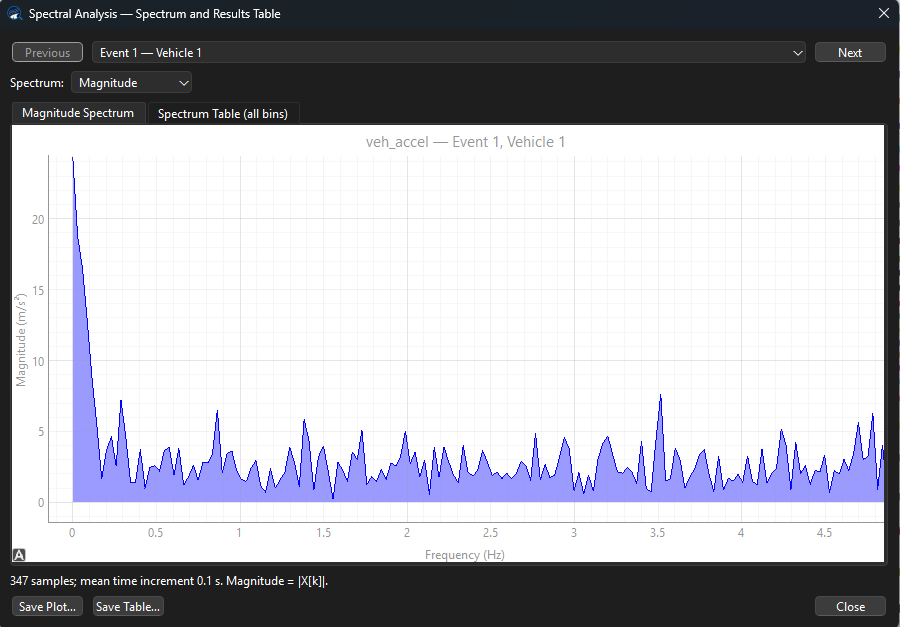

*Figure 50 Spectral Analysis magnitude spectrum*

The **Spectrum Table (all bins)** tab shows every frequency bin, including those beyond the plotted half-spectrum. Changing the Spectrum dropdown only changes the plot — the table and CSV exports always contain the raw Fourier coefficients and magnitudes. **Save Table…** saves all bins for the currently displayed vehicle to CSV; use Export Analysis when you need multiple events or vehicles.

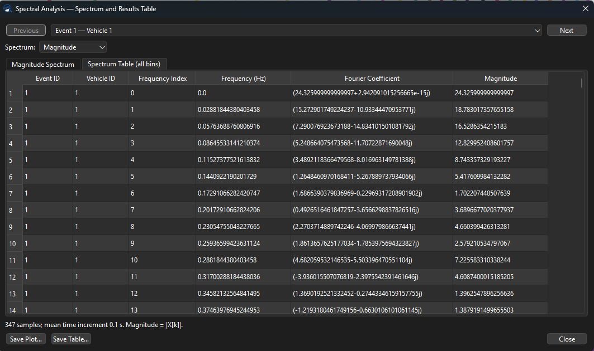

*Figure 51 Spectral Analysis all-bin results table*

---

## 16. Advanced Statistics

Advanced Statistics calculates, summarizes, plots, and exports statistics describing the **interactions between trajectories**: leader/follower relationships, how long and how continuously vehicles follow one another, how often leaders and followers change, and the gaps involved in lane changes. It only reads the database; nothing is written.

Open it from the right-click menu with **Statistics → Advanced Statistics** ([§8](#8-right-click-menu-on-the-plot)):

- right-click **one trajectory** or a **selection** to report those vehicles, or
- right-click empty space with **nothing selected** to report every vehicle of the event, in every lane.

Leaders and followers are always identified from **every** trajectory of the event, even when only one vehicle is reported.

### 16.1 Parameters

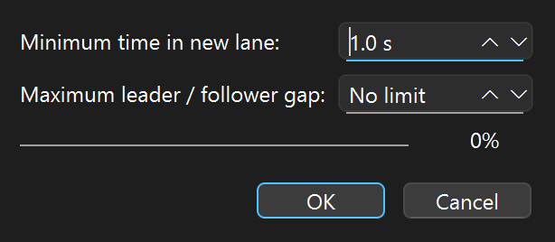

*Figure 52 Advanced Statistics parameter dialog*

- **Minimum time in new lane** (s, default 1) — a move to another lane counts as a lane change only when the vehicle stays in the new lane at least this long. Shorter flips are ignored, so a vehicle flickering between two lanes and settling where it started has made no lane change.
- **Maximum leader / follower gap** (m, default "No limit") — a vehicle further than this ahead (behind) in the same lane is not counted as a leader (follower).

### 16.2 How Leaders, Followers, and Lane Changes Are Identified

All vehicles of an event travel in the same direction. At each timestamp of the event's sampling grid:

- a vehicle's **leader** is the nearest vehicle ahead of it in the same lane, and its **follower** the nearest vehicle behind it — the same notion as Gap Headway mode;
- gaps are measured center to center, as the difference in distance traveled.

Each trajectory's position is interpolated onto the grid within its gap-free segments, so a trajectory is neither a leader nor a follower during a gap in its data. Lane-corrected rows count with their corrected lane.

For each valid lane change:

- the **accepted gap** is the space in the target lane, just before the change, between the nearest vehicle ahead of the subject's position and the nearest vehicle behind it;
- the **front gap** and **rear gap** are the distances to the vehicle's new leader and new follower just after the change.

A gap with no vehicle on one side is left out of the statistics.

### 16.3 The Results Table

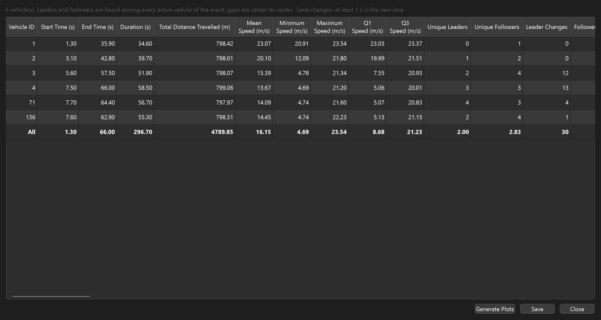

*Figure 53 Advanced Statistics results table*

The table has one row per reported vehicle, ordered by vehicle ID, followed by a bold summary row, **All**, over every vehicle in the table. Hover over a column header for the statistic's full name and definition. Values that can't be computed — no leader, no lane change, or no `veh_speed` column — show as N/A.

| Column | Description |
|---|---|
| Vehicle ID | Identifier of the analyzed trajectory |
| Start Time, End Time | First and last valid timestamp of the trajectory |
| Duration | Total duration of the trajectory |
| Total Distance Travelled | Total distance traveled by the trajectory |
| Speed: Mean, Minimum, Maximum, Q1, Q3 | Statistics of the trajectory's speed |
| Unique Leaders, Unique Followers | Number of distinct vehicles identified as leaders / followers |
| Leader Changes, Follower Changes | Number of times the assigned leader / follower changes |
| Maximum Continuous Following Time | Longest uninterrupted time spent following one leader |
| Maximum-Time Leader ID | The leader of that longest following interval |
| Maximum Continuous Followed Time | Longest uninterrupted time spent being followed by one follower |
| Maximum-Time Follower ID | The follower of that longest followed interval |
| Leader Gap: Mean, Minimum, Maximum, Q1, Q3 | Distance to the assigned leader |
| Follower Gap: Mean, Minimum, Maximum, Q1, Q3 | Distance to the assigned follower |
| Number of Lane Changes | Number of valid lane changes |
| Accepted Gap Space Before Lane Change: Mean, Minimum, Maximum, Q1, Q3 | Target-lane gap available before lane changes |
| Front Gap After Lane Change: Mean, Minimum, Maximum, Q1, Q3 | Distance to the new leader after lane changes |
| Rear Gap After Lane Change: Mean, Minimum, Maximum, Q1, Q3 | Distance to the new follower after lane changes |

Q1 and Q3 are the first and third quartiles (25th and 75th percentiles). In the **All** row, a quantity with the full set of statistics (mean, minimum, maximum, Q1, Q3) is computed from every vehicle's samples pooled together; counts and times are summarized as their minimum, maximum, sum, or mean as appropriate.

**Save** writes the table, summary row included, to a CSV file (N/A values are left blank). **Close** closes the table.

### 16.4 Box Plots

**Generate Plots** opens a list of the quantities with the full set of statistics — Speed, Leader Gap, Follower Gap, Accepted Gap Space Before Lane Change, Front Gap After Lane Change, and Rear Gap After Lane Change. Check any number of them and click **Confirm** to open one box plot per quantity, each built from the samples of every vehicle in the table, with outliers labeled by vehicle and time ([§15.1](#151-the-shared-pattern)).

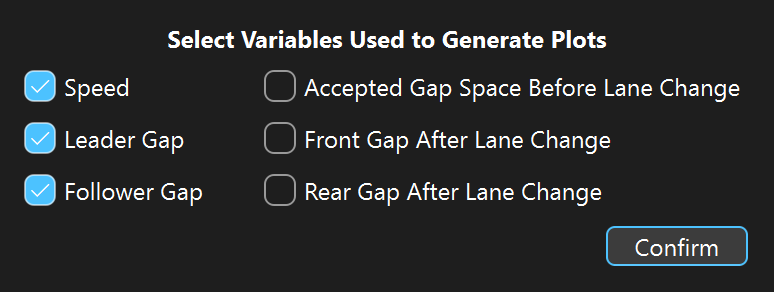

*Figure 54 Generate Plots variable selection*

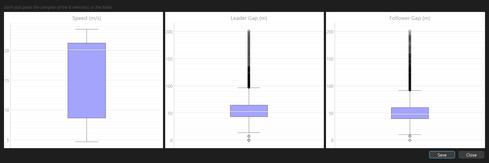

*Figure 55 Advanced Statistics box plots*

---

## 17. Exporting Data

File → Export gathers every way to get data back out of TRACES as CSV. The submenu itself is disabled until a database is open (see [§6](#6-main-window-tour)):

- **Export All** — every column, every record, the whole database.
- **Export Selected** — chosen columns for one event.
- **Export Analysis** — Jerk Analysis, Missing Data, Internal Consistency, Platoon Consistency, and Spectral Analysis, each writing that analysis's results straight to CSV.

All three use the same batched producer/consumer export with a progress bar and an **Interrupt** button; closing an export dialog while it's running asks you to confirm before canceling the export.

**Corrected data in exports.** Export All and Export Selected write rows exactly as they are in the database: gap fills, lane corrections, synthetic Spline Fitting rows, and the segments removed by stitching are all included. Export the `imputed_status` and `traj_status` columns ([§10](#10-changing-data-write-targets-and-row-status)) to tell them apart — for example, to keep only the processed trajectories, drop the rows whose `traj_status` is `R`.

### 17.1 Export All

Shows the total record count that will be exported, then writes every column in the events table for every event to a single CSV file. Choose the output location; if the file already exists, you're asked to confirm overwriting it.

### 17.2 Export Selected

Lets you export a subset of columns for a single event:

- Pick the **event** from the dropdown.
- Choose which **columns** to include from the multi-select list, or use **Select All** / **Select None**. At least one column is required.
- Your column selection is remembered for the next time you open this dialog during the session.

A note in the dialog reminds you that the resulting file only contains the selected columns for one event and **cannot be re-imported** back into TRACES — this path is for taking a slice of data out to another tool, not for round-tripping.

*Figure 56 Export Selected dialog*

### 17.3 Export Analysis

Runs Jerk Analysis, Missing Data, Internal Consistency, Platoon Consistency, or Spectral Analysis ([§15](#15-analysis-menu--jerk-missing-data-internal-consistency-platoon-consistency-and-spectral-analysis)) purely to produce a CSV — no results dialog is shown, and nothing is written to the database.

Choosing an Export Analysis item first opens the [event selection list](#111-data--spline-fitting) so you can pick one or more events, then opens that module's parameter dialog with a **Save** button in place of OK. The analysis runs across every vehicle in each selected event.

*Figure 57 Export Analysis submenu*

Results of the other modules are saved from their own windows: the Spline Fit Statistics table ([§11](#11-data-menu--spline-fitting)), the shockwave results table ([§9.3](#93-shockwave)), and the Advanced Statistics table ([§16](#16-advanced-statistics)) each have a Save button.

### Completion

Every export path — All, Selected, or Analysis — ends with a confirmation dialog reporting success (including the number of records written, for Export All/Selected) or an error message if something went wrong.

*Figure 58 Export completion dialog*

---

## 18. Vehicle Search

**View → Search Vehicle** opens a small, modeless tool window for jumping straight to a specific vehicle's trajectory by ID, without hunting for it visually on the plot. It's enabled only while the plot is in Time-Space Diagram mode with an event confirmed ([§6](#6-main-window-tour), [§9.1](#91-select-trajectory)) — switching to Gap Headway or Shockwave mode, or reopening the event settings dialog, closes it automatically.

Because it's modeless, it stays open alongside the plot rather than blocking interaction — you can search for one vehicle, look at it, and search for another without reopening the dialog. Its list is updated when trajectories are added or removed by stitching.

**Using it:**

1. Type digits into the search field. The list below live-filters to every vehicle ID that *contains* those digits anywhere (not just as a prefix), capped at 200 results with a "Showing N of M matches" note if there are more.
2. Click (or double-click/press Enter on) a result to select it.

**What happens on selection:** if the vehicle already has loaded data in the currently displayed lane, it's selected and framed immediately. If it's on a different lane, TRACES finds the lane where that vehicle first appears, switches to it, then selects and frames the vehicle there. Framing snaps the time and distance sliders to the vehicle's exact trajectory extent (no padding) — the slider *ranges* only expand if the trajectory falls completely outside the current view, so you don't lose your broader context unnecessarily. The found vehicle becomes the sole selection, dimming every other trajectory.

*Figure 59 Vehicle Search dialog with a filtered result list*

---

## 19. System Log Viewer

**View → Log** opens the **System Log Viewer**, a modeless window showing the application's running log file — always available, regardless of whether a database is open. Opening it again while it's already open brings the existing window forward (restoring it if minimized) rather than opening a second copy.

The viewer displays `traces.log`, the same file the [Import dialog](#42-importing-csv-data) writes its timestamped messages to, in a read-only, monospaced, non-wrapping text area. It polls the file twice a second and appends any new lines, so it stays current whether or not an import is actively running — you can leave it open across an entire import to watch progress alongside the Import dialog's own log, or open it independently at any time to review recent activity. New content only auto-scrolls into view if you're already scrolled to the bottom, so you can scroll up to read earlier entries without being pulled back down.

If the log file is cleared out from under it — for instance, the Import dialog clears it at the start of each new import — the viewer detects the file shrinking and clears its own display to match, then continues appending from there.

*Figure 60 System Log Viewer window*

---

## 20. About Dialog

**File → About** shows the TRACES logo, the version number, and a summary of the application's purpose, features, and requirements. Click **Close** to return to the application.

*Figure 61 About dialog*

---

This covers TRACES end to end, from the start screen through importing data, plotting and interacting with trajectories, correcting data, running analyses, and exporting results. For the format of the JSON configuration files referenced throughout the import sections, see the *TRACES Configuration Guide*.
