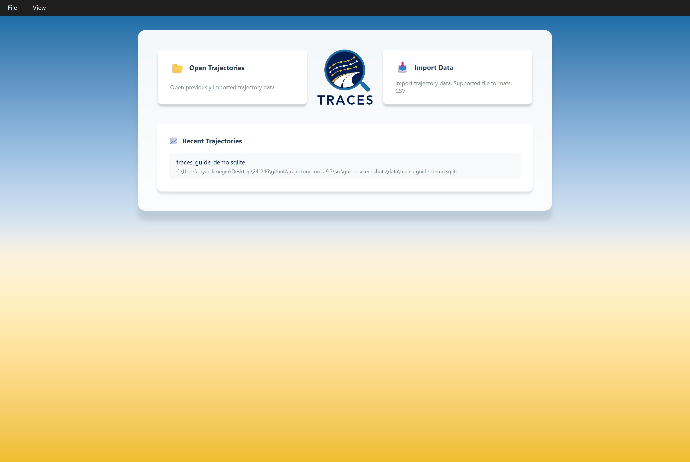
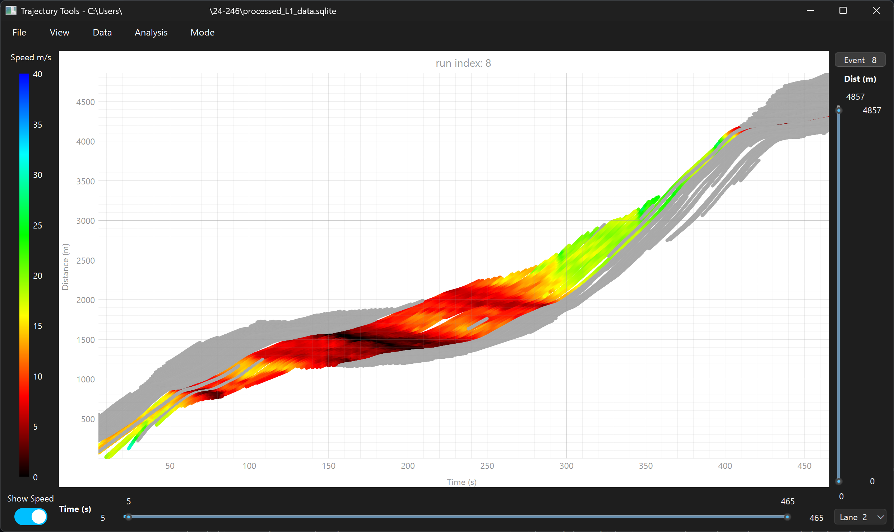
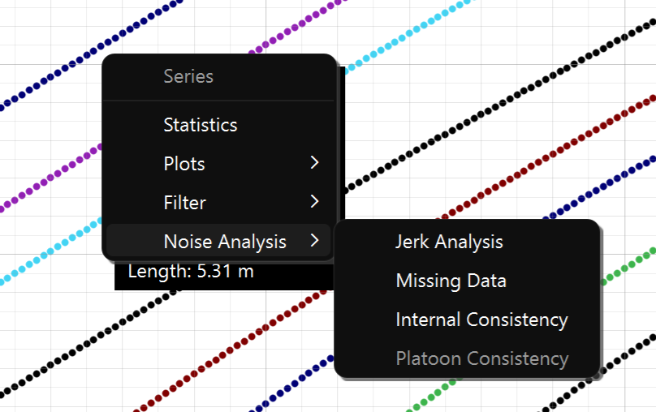
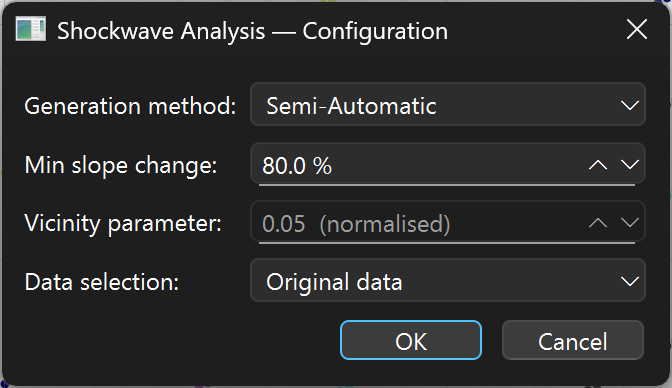
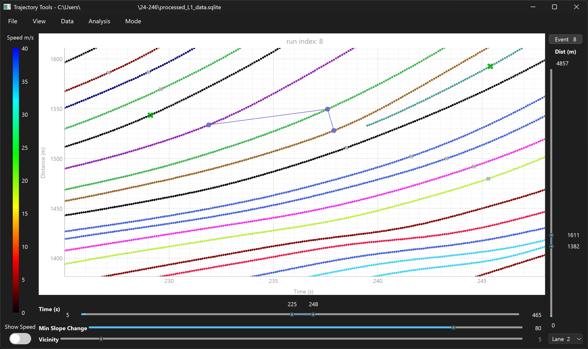
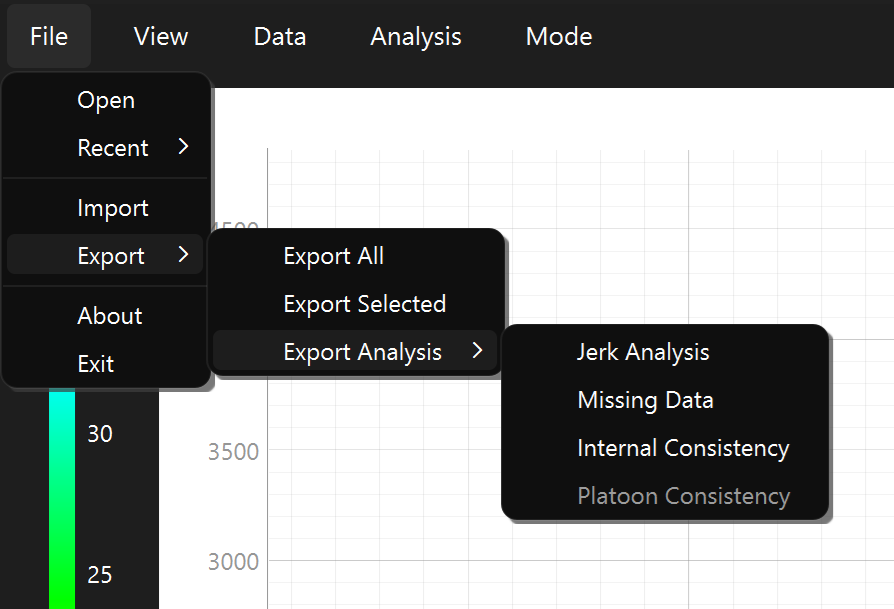

# Trajectory Tools User Guide

## Table of Contents

- [1. Introduction](#1-introduction)
- [2. Getting Started](#2-getting-started)
- [3. Opening a Database vs. Importing CSV Data](#3-opening-a-database-vs-importing-csv-data)
- [4. Selecting an Event to Plot](#4-selecting-an-event-to-plot)
- [5. Main Window Tour](#5-main-window-tour)
- [6. The Time-Space Plot](#6-the-time-space-plot)
- [7. Right-Click Menu on the Plot](#7-right-click-menu-on-the-plot)
- [8. Interaction Modes](#8-interaction-modes)
- [9. Data Menu — Spline Fitting](#9-data-menu--spline-fitting)
- [10. Analysis Menu — Jerk, Missing Data, Internal Consistency](#10-analysis-menu--jerk-missing-data-internal-consistency)
- [11. Exporting Data](#11-exporting-data)
- [12. Vehicle Search](#12-vehicle-search)
- [13. System Log Viewer](#13-system-log-viewer)
- [Configuration Guide](trajectory-tools-config-guide.md)

---

## Table of Figures

| Figure | Title | Section |
|---|---|---|
| Figure  1 | Trajectory Tools main window showing a populated time-space plot | [1. Introduction](#1-introduction) |
| Figure  2 | Start screen with no recent files | [2. Getting Started](#2-getting-started) |
| Figure  3 | Start screen with recent files populated | [2. Getting Started](#2-getting-started) |
| Figure  4 | File menu showing Open, Recent, and Import | [3. Opening a Database vs. Importing CSV Data](#3-opening-a-database-vs-importing-csv-data) |
| Figure  5 | Import dialog with input file selected, ready to import | [3. Opening a Database vs. Importing CSV Data](#3-opening-a-database-vs-importing-csv-data) |
| Figure  6 | Import dialog mid-import with progress | [3. Opening a Database vs. Importing CSV Data](#3-opening-a-database-vs-importing-csv-data) |
| Figure  7 | Import completion popup on success | [3. Opening a Database vs. Importing CSV Data](#3-opening-a-database-vs-importing-csv-data) |
| Figure  8 | Time Space Plot Settings dialog for a newly opened database | [4. Selecting an Event to Plot](#4-selecting-an-event-to-plot) |
| Figure  9 | Vehicle Limit Exceeded warning dialog | [4. Selecting an Event to Plot](#4-selecting-an-event-to-plot) |
| Figure 10 | Analysis menu open, showing two disabled placeholder items | [5. Main Window Tour](#5-main-window-tour) |
| Figure 11 | Mode menu open with Select Trajectory checked | [5. Main Window Tour](#5-main-window-tour) |
| Figure 12 | Time-space plot with data loaded, no selection | [6. The Time-Space Plot](#6-the-time-space-plot) |
| Figure 13 | Time-space plot with Show Speed enabled and a selection active | [6. The Time-Space Plot](#6-the-time-space-plot) |
| Figure 14 | Right-click menu in the "All" context | [7. Right-Click Menu on the Plot](#7-right-click-menu-on-the-plot) |
| Figure 15 | Noise Analysis submenu expanded | [7. Right-Click Menu on the Plot](#7-right-click-menu-on-the-plot) |
| Figure 16 | Gap Headway mode with a locked overlay | [8. Interaction Modes](#8-interaction-modes) |
| Figure 17 | Shockwave configuration dialog | [8. Interaction Modes](#8-interaction-modes) |
| Figure 18 | Shockwave chain under construction | [8. Interaction Modes](#8-interaction-modes) |
| Figure 19 | Committed shockwave with the floating results panel | [8. Interaction Modes](#8-interaction-modes) |
| Figure 20 | Shockwave results table | [8. Interaction Modes](#8-interaction-modes) |
| Figure 21 | Event selection checklist | [9. Data Menu — Spline Fitting](#9-data-menu--spline-fitting) |
| Figure 22 | Spline Fitting parameter dialog | [9. Data Menu — Spline Fitting](#9-data-menu--spline-fitting) |
| Figure 23 | Spline Fit Statistics results table | [9. Data Menu — Spline Fitting](#9-data-menu--spline-fitting) |
| Figure 24 | Right-click Spline Fitting preview dialog | [9. Data Menu — Spline Fitting](#9-data-menu--spline-fitting) |
| Figure 25 | Jerk Analysis parameter dialog | [10. Analysis Menu — Jerk, Missing Data, Internal Consistency](#10-analysis-menu--jerk-missing-data-internal-consistency) |
| Figure 26 | Jerk Analysis box plot results | [10. Analysis Menu — Jerk, Missing Data, Internal Consistency](#10-analysis-menu--jerk-missing-data-internal-consistency) |
| Figure 27 | Missing Data parameter dialog | [10. Analysis Menu — Jerk, Missing Data, Internal Consistency](#10-analysis-menu--jerk-missing-data-internal-consistency) |
| Figure 28 | Internal Consistency combined results dialog | [10. Analysis Menu — Jerk, Missing Data, Internal Consistency](#10-analysis-menu--jerk-missing-data-internal-consistency) |
| Figure 29 | Export Selected dialog | [11. Exporting Data](#11-exporting-data) |
| Figure 30 | Export Analysis submenu | [11. Exporting Data](#11-exporting-data) |
| Figure 31 | Export completion dialog | [11. Exporting Data](#11-exporting-data) |
| Figure 32 | Vehicle Search dialog with a filtered result list | [12. Vehicle Search](#12-vehicle-search) |
| Figure 33 | System Log Viewer window | [13. System Log Viewer](#13-system-log-viewer) |

---

## 1. Introduction

Trajectory Tools is a desktop application for importing, visualizing, and analyzing vehicle trajectory data — the detailed, time-stamped position records produced by cameras, radar, connected-vehicle systems, and other sensing technologies used in traffic research.

As trajectory data has become more widely available, so has the need for a tool that can bring data from different sources into one consistent format and make it usable without custom scripting for every dataset. Trajectory Tools addresses that need with a modular, configuration-driven approach: any CSV file whose columns are described in a JSON configuration file can be imported into a common SQLite database structure, then explored and analyzed the same way regardless of where the data originated.

Once data is imported, Trajectory Tools centers on an interactive **time-space plot** — vehicle position plotted against time — that supports panning, zooming, trajectory selection, and a set of interaction modes for tasks like measuring gaps and headways or identifying shockwaves. A set of built-in analyses (jerk, missing data, internal consistency, spline-based smoothing) can be run against one or more events, with results shown as tables, statistics, and plots, and exported to CSV for use elsewhere.

This guide walks through the application in the order you're likely to use it: getting data in, exploring it on the plot, running analyses, and exporting results. For details on writing a JSON configuration file for a new CSV format, see the separate [Configuration Guide](trajectory-tools-config-guide.md).

*The main window with a database open and an event plotted: the time-space plot in the center, the speed gradient bar and "Show Speed" toggle on the left, time/distance range sliders and lane selector on the right, and the full menu bar (File, View, Data, Analysis, Mode) visible across the top.*

*Figure 1 Trajectory Tools main window showing a populated time-space plot*

---

## 2. Getting Started

### Launching the Application

Start Trajectory Tools from its shortcut or executable like any other desktop application. On first launch the window opens at 80% of your screen size, centered; on subsequent launches it restores the size and position (including maximized state) from your last session.

### The Start Screen

Trajectory Tools opens to a start screen with two options and a recent-files list:

- **Open Trajectories** — open an existing trajectory database (a `.sqlite` file previously created by importing CSV data).
- **Import Data** — import a new CSV file into a new trajectory database.
- **Recent Trajectories** — up to seven previously opened databases, most recent first, shown by filename and full path. Click any entry to open it directly. If none exist yet, this section reads "No recent files."

*Start screen on first launch: the two-card layout (Open Trajectories / Import Data) and an empty "No recent files" state below.*

*Figure 2 Start screen with no recent files*

*Start screen after several databases have been opened, showing the Recent Trajectories list with multiple entries.*

*Figure 3 Start screen with recent files populated*

These same two actions are also available from the **File** menu (**Open** and **Import**), covered next.

---

## 3. Opening a Database vs. Importing CSV Data

Trajectory Tools works with two kinds of files:

- **CSV files** — raw trajectory data as originally collected, in whatever column layout your source provides.
- **SQLite databases** (`.sqlite`) — the application's own standardized format, created by importing a CSV file once. All of the plotting, analysis, and export features work against this database, not the original CSV.

You'll typically import a CSV once, then reopen the resulting database directly on future sessions.

*File menu expanded, with the Recent submenu showing several previously opened databases.*

*Figure 4 File menu showing Open, Recent, and Import*

### 3.1 Opening an Existing Database

Use **File → Open**, choose an entry from **File → Recent** (up to seven, most recent first), or click **Open Trajectories** on the start screen. All three lead to the same place.

For File → Open, a standard file dialog is filtered to `.sqlite` / `.db` files. Once a file is chosen, Trajectory Tools validates it before doing anything else:

- it must contain an `events` table with the required columns (`event_id`, `veh_id`, `veh_time`, `lane_id`, `veh_dist_trav`),
- it must contain a `ranges` table (this is written last during import, so its presence confirms the import completed),
- the `events` table must have at least one record.

If any check fails, an error dialog explains specifically what's wrong (e.g. a missing `ranges` table suggests the source import didn't finish and should be re-run) and the file is not opened.

On success, the window title updates to show the file path, the file moves to the top of the Recent list, and the **[Time Space Plot Settings dialog](#4-selecting-an-event-to-plot)** opens automatically so you can choose what to plot. If you cancel that dialog instead of applying settings, the database is closed again and you're returned to the start screen — Trajectory Tools never leaves a database "open" in the background without a plot attached to it.

### 3.2 Importing CSV Data

Use **File → Import** or click **Import Data** on the start screen to open the Import dialog.

**Configuration files.** Before anything can be imported, Trajectory Tools needs at least one JSON configuration file describing a CSV layout, kept in the application's `config` folder. On opening, the dialog scans that folder, validates each `.json` file it finds, and lists the valid ones as available file types (by filename). Configurations that fail validation are excluded and reported in the log. Writing these configuration files is covered in the separate **[Configuration Guide](trajectory-tools-config-guide.md)** — this guide only covers using the Import dialog itself.

*Import dialog after selecting an input CSV: the log area shows the available file types and the selected input/output paths, with the Output and Import buttons enabled.*

*Figure 5 Import dialog with input file selected, ready to import*

**Running an import:**

1. Click **Input** and choose a CSV file. The file type filter is built from your available configurations. The output database path is set automatically (same name, `.sqlite` extension) but can be changed with **Output**.
2. Click **Import** to begin. The configuration is fully re-validated (this time every message is logged, including informational ones about column mappings), then the import runs on a background thread so the dialog stays responsive.
3. The log area streams timestamped progress, warnings, and errors; the progress bar advances as records are processed. **Interrupt** stops the import after a confirmation prompt — an interrupted or failed import removes the partial output file rather than leaving a corrupt database behind.

*Import dialog partway through an import: progress bar around 60%, log area scrolled to recent messages, Interrupt button enabled.*

*Figure 6 Import dialog mid-import with progress*

**When it finishes**, a completion popup appears:

- **Success** — "Continue" closes the Import dialog and opens the Time Space Plot Settings dialog for the new database (same as opening it directly); "Back" returns to the Import dialog so you can import another file in the same session.
- **Failure** — only "Back" is offered, so you can review the log to see what went wrong before trying again.

*The "Import Complete" popup with its message text and the Continue / Back buttons.*

*Figure 7 Import completion popup on success*

Duplicate records (identical `event_id`, `veh_id`, and `veh_time`) are silently skipped rather than duplicated, so re-running an import over the same data is safe.

---

## 4. Selecting an Event to Plot

Whenever a database is opened — via File → Open, a Recent entry, or right after a successful import — Trajectory Tools shows the **Time Space Plot Settings** dialog before displaying anything. This dialog is where you choose *which* event to look at and *how much* of it to plot. It reappears any time you click the **event button** at the top of the plot itself, so you can change events or narrow your range later without starting over.

*Settings dialog immediately after opening a database: event name centered at top, the Event dropdown with Lanes and Total Vehicles counts beside it, the Time and Distance range sliders below (each spanning the event's full extent), and the record-count readout and Apply button at the bottom.*

*Figure 8 Time Space Plot Settings dialog for a newly opened database*

### Choosing an Event

The **Event** dropdown lists every event found in the database (from its `ranges` table), labeled `Event N`. Selecting one updates:

- the event name label at the top (or blank if the configuration didn't provide one),
- **Lanes** — the lane IDs present in the event; hover for a tooltip showing original source-lane IDs, if your configuration preserved them,
- **Total Vehicles** — the full vehicle count for the event, independent of any range filtering,
- both range sliders, reset to the event's full time and distance extent.

### Narrowing the Range

The **Time (s)** and **Distance (m)** sliders each have two handles, letting you filter to a sub-range of the event rather than plotting everything at once. They're linked to each other: releasing the time slider re-queries the actual distance extent of vehicles present within that time window and snaps the distance slider to fit (and releasing the distance slider does the same for time). This makes it easy to zero in on a busy or interesting window on one axis without having to guess the corresponding range on the other.

### The Vehicle Count Limit

Below the sliders, a label reads **"N of 500 vehicle limit"** and updates every time either slider is released, counting the distinct vehicles that fall within the current time *and* distance window. It's colored green while at or under 500 and red when over. This limit is advisory, not a hard cap — it exists because plotting a very large number of trajectories at once can slow the plot down.

If you click **Apply** while over the limit, a warning dialog tells you how many vehicles are selected and asks whether to continue anyway (**OK**) or go back and narrow the range further (**Cancel**, the default).

*Warning shown on Apply when the selected time/distance window contains more than 500 vehicles, with the count filled in and Cancel as the highlighted default.*

*Figure 9 Vehicle Limit Exceeded warning dialog*

### Applying Settings

**Apply** is always enabled. Once confirmed (directly, or after accepting the over-limit warning), the dialog closes and the main window either builds the time-space plot for the first time or updates the existing one with the new event/range.

If you cancel this dialog instead:
- **On first open** (right after opening or importing a database, before any plot exists), the database is closed and you're returned to the start screen — Trajectory Tools doesn't leave a database open with nothing plotted.
- **On later reopens** (via the plot's event button), canceling simply leaves the plot exactly as it was; nothing is lost.

### Reopening Later

Click the event button at the top of the time-space plot at any time to bring this dialog back up. It reopens pre-filled with the currently active event, time range, and distance range as a starting point, so you can adjust the filters without losing your place — see [Section 6](#6-the-time-space-plot) for where this button lives on the plot itself.

---

## 5. Main Window Tour

Before diving into each feature in depth, here's the shape of the main window: what's on the menu bar, when each menu appears, and where to find the full details later in this guide.

### Window Title and Database State

The title bar reads **"Trajectory Tools"** at the start screen and becomes **"Trajectory Tools — `<file path>`"** once a database is open. Opening a different database while one is already active (via File → Open, Recent, or Import) doesn't open a second window — it reuses the same plot area, closing the previous connection and loading the newly opened database's data in place once you confirm an event in the settings dialog.

### Menu Availability at a Glance

| Menu | Visible at start | Becomes available when… | Covered in |
|------|------------------|--------------------------|------------|
| **File** | Yes, always | — | §3, §11, §14 |
| **View** | Yes, always (Search Vehicle item stays disabled until an event is confirmed) | — | §6, §12, §13 |
| **Data** | Hidden | the Time Space Plot Settings dialog is accepted | §9 |
| **Analysis** | Hidden | same as Data | §10 |
| **Mode** | Hidden | a plot has actually been created (first event confirmed) | §8 |

Canceling out of a database entirely (see §4) hides Data, Analysis, and Mode again and returns the window to this starting state.

### File Menu

- **Open**, **Recent** (up to 7 entries; grayed out when empty), and **Import** are always available — see [§3](#3-opening-a-database-vs-importing-csv-data).
- **Export** — All / Selected / Analysis (Jerk, Missing Data, Internal Consistency; **Platoon Consistency** is present but disabled, reserved for a not-yet-implemented module) — stays grayed out until a database is open. Covered in [§11](#11-exporting-data).
- **About** and **Exit** are always available — see [§14](#14-about-dialog).

### View Menu

- **Search Vehicle** is only enabled while the plot is in Select interaction mode *and* an event is confirmed; it's automatically disabled (and its dialog closed) the moment you switch to Gap Headway or Shockwave mode, or while the settings dialog is open. See [§12](#12-vehicle-search).
- **Log** is always available and opens the modeless System Log Viewer. See [§13](#13-system-log-viewer).

### Data Menu

A single item, **Spline Fitting**, which first asks you to select one or more events, then opens the Spline Fitting parameters dialog. Unlike the Analysis menu's top-level items, this one can process several events in a single run. See [§9](#9-data-menu--spline-fitting).

### Analysis Menu

**Jerk Analysis**, **Missing Data**, and **Internal Consistency** each run against whichever event is currently plotted when launched from this menu (running them against other events requires the right-click plot menu or Export Analysis — see [§7](#7-right-click-menu-on-the-plot) and [§11](#11-exporting-data)). **Platoon Consistency** and **Spectral Analysis** are visible but disabled — they're reserved placeholders for analysis modules that haven't been implemented yet. Full details in [§10](#10-analysis-menu--jerk-missing-data-internal-consistency).

*Analysis menu with Jerk Analysis, Missing Data, and Internal Consistency enabled, and Platoon Consistency / Spectral Analysis grayed out as not-yet-implemented placeholders.*

*Figure 10 Analysis menu open, showing two disabled placeholder items*

### Mode Menu

Populated only once a plot exists, with three mutually exclusive, checkable actions: **Select Trajectory** (the default), **Gap Headway**, and **Shockwave**. Selecting Shockwave first prompts for configuration; only its **Semi-Automatic** method is currently implemented — Manual and Automatic appear in that configuration dialog but are disabled for now. Full behavior in [§8](#8-interaction-modes).

*Mode menu showing the three checkable interaction modes, with Select Trajectory active (checked) by default.*

*Figure 11 Mode menu open with Select Trajectory checked*

---

## 6. The Time-Space Plot

The time-space plot is the application's central view: vehicle position (distance traveled) plotted against time, one point per recorded observation, one lane at a time.

*Full plot widget layout: the vertical speed-gradient legend and "Show Speed" toggle on the left, the plot canvas with the horizontal time range slider beneath it in the center, and the event button, vertical distance range slider, and lane dropdown on the right.*

*Figure 12 Time-space plot with data loaded, no selection*

### Layout

- **Left — Speed gradient.** A vertical color-scale legend (0–40 m/s by default) paired with a **Show Speed** toggle switch. Off by default; when on, every plotted point is colored by its instantaneous speed instead of by vehicle, letting you spot slow/fast regions at a glance. See "Coloring by Speed" below.
- **Center — Plot canvas and time range.** The scatter plot itself (time on the x-axis, distance on the y-axis), with a horizontal two-handle **Time (s)** slider directly beneath it controlling the visible time window. (When Shockwave mode is active, two additional sliders — Min Slope Change and Vicinity — appear here; see [§8](#8-interaction-modes).)
- **Right — Event, distance, and lane.** The **event button** at the top reopens the [Time Space Plot Settings dialog](#4-selecting-an-event-to-plot) to change events or ranges; below it, a vertical two-handle **Dist (m)** slider controls the visible distance window; below that, a **lane** dropdown selects which lane's trajectories are currently plotted.

The plot always shows one lane at a time — switch lanes from the dropdown to see another. The plot title shows the event's name (or "Event N" if none was configured).

### Panning and Zooming

The time and distance sliders are the primary way to pan and zoom: drag a handle to narrow the range, or drag the whole slider to shift the window. Scrolling the mouse wheel over the plot zooms in or out centered on the cursor position, adjusting both sliders together to preserve the plot's aspect ratio. Zooming is limited to a minimum span on each axis — you can't zoom in indefinitely — and is clamped so you can't pan past the event's full extent. The plot's own drag-to-pan and built-in zoom controls are disabled in favor of these slider-driven controls.

### Hovering for Detail

Hovering near a point shows a tooltip with that vehicle's lane, speed, acceleration, automation status, and length (where those columns are present in your imported data — see the [Configuration Guide](trajectory-tools-config-guide.md#data-dictionary) for which columns are optional).

### Selecting Trajectories

In the default **Select Trajectory** mode ([§8](#8-interaction-modes)):

- **Click** near a point to toggle that vehicle's selection on or off.
- **Shift+drag** draws a selection box; every vehicle with at least one point inside it is added to the selection (or removed, if you shift-drag over already-selected vehicles).
- Once anything is selected, unselected vehicles are dimmed to a flat gray so the selection stands out. Selecting *every* vehicle in the lane automatically clears the selection and returns to normal coloring, since dimming nothing is equivalent to no selection.

Your selection determines what several right-click menu items act on — one vehicle, a specific selected group, or all — covered next in [§7](#7-right-click-menu-on-the-plot).

### Coloring by Speed

Toggling **Show Speed** on the left replaces each vehicle's flat color with a per-point color drawn from the gradient legend, based on that point's recorded speed (points without a speed value, or where the dataset has no `veh_speed` column, are shown at the low end of the gradient). Dimming from an active selection still applies on top of the gradient — dimmed points stay flat gray regardless of speed.

*Speed gradient toggle on: plotted points colored along the legend by instantaneous speed, with several vehicles selected and the rest dimmed gray.*

*Figure 13 Time-space plot with Show Speed enabled and a selection active*

---

## 7. Right-Click Menu on the Plot

Right-clicking anywhere on the plot canvas opens a context menu. Its title and the vehicles it acts on depend on where you clicked and what's currently selected:

| Context | When it applies | Title shown | Vehicles acted on |
|---------|------------------|-------------|--------------------|
| **Series** | You right-click directly on a trajectory | "Series" | Just that one vehicle, regardless of any existing selection |
| **Selected** | You right-click empty space while one or more vehicles are selected | "Selected" | Every currently selected vehicle |
| **All** | You right-click empty space with nothing selected | "All" | Every vehicle currently plotted in the visible lane |

The context name appears as a non-clickable heading at the top of the menu, so you always know which of the three you're in before choosing an item.

*Context menu opened on empty plot space with nothing selected: "All" heading at top, Statistics enabled, Plots submenu items grayed out (not available outside Selected/Series), Filter and Noise Analysis available.*

*Figure 14 Right-click menu in the "All" context*

### Statistics

Available in every context. Opens a table of summary statistics (speed and acceleration) for the target vehicle(s). If the dataset has neither `veh_speed` nor `veh_accel`, the dialog explains that no statistics can be computed instead of showing an empty table.

### Plots

**Time-Speed Plot** and **Time-Accel Plot** open a plot of the target vehicle(s)' speed or acceleration over time, for the current lane and the plot's active time range. Both are restricted to the **Selected** and **Series** contexts — you need something selected or clicked on, since plotting "All" would rarely be useful — and each requires the corresponding `veh_speed` or `veh_accel` column to exist in your imported data; if it doesn't, the item is grayed out with a tooltip naming the missing column.

### Filter — Spline Fitting

Opens a preview-only spline fitting window for a single trajectory, letting you try different smoothing parameters against the measured data without writing anything to the database (this is the second of two spline fitting entry points — see [§9](#9-data-menu--spline-fitting) for the full comparison with Data → Spline Fitting). This item is available in all three contexts but only enabled when exactly one vehicle is targeted — right-click directly on a trajectory, or narrow a selection down to one vehicle first, to unlock it. Otherwise it's grayed out with the tooltip "Filtering is only available when one trajectory is selected."

### Noise Analysis

**Jerk Analysis**, **Missing Data**, and **Internal Consistency** run the same analyses available from the top-level Analysis menu ([§10](#10-analysis-menu--jerk-missing-data-internal-consistency)), but scoped to whatever the right-click context implies — the clicked vehicle, your current selection, or every vehicle in the visible lane for "All." This is an important distinction from the Analysis menu: launching an analysis from there always runs against **every vehicle in the entire event**, regardless of lane or selection, while launching it here always runs against the **current context's vehicles in the current lane only**. **Platoon Consistency** is present but disabled — reserved for a not-yet-implemented module.

*Noise Analysis submenu open in a "Selected" context, showing Jerk Analysis, Missing Data, and Internal Consistency enabled and Platoon Consistency grayed out.*

*Figure 15 Noise Analysis submenu expanded*

---

## 8. Interaction Modes

The **Mode** menu switches how clicking and hovering on the time-space plot behaves. Only one mode is active at a time.

### 8.1 Select Trajectory

The default mode, covered in [§6](#6-the-time-space-plot): click to toggle a vehicle's selection, shift-drag to box-select multiple vehicles. Most other features (Statistics, Plots, Filter, Noise Analysis in the right-click menu; Vehicle Search) assume you're in this mode.

### 8.2 Gap Headway

Gap Headway mode overlays spacing information for individual points instead of selecting trajectories:

- **Hover** near a point to see a transient overlay showing that vehicle's **gap** (distance to the nearest vehicle ahead/behind at that instant) and **headway** (time to the nearest vehicle ahead/behind passing the same position), drawn as connecting lines with labels. The overlay disappears when you move away.
- **Click** a point to lock its overlay in place so it stays visible while you inspect others; click a locked point again to unlock it.
- Locked points persist even if you temporarily switch to another mode and back to Gap Headway.
- Press **Escape** to clear every locked point at once.

*Gap Headway mode showing a locked point's gap and headway lines and labels relative to neighboring trajectories.*

*Figure 16 Gap Headway mode with a locked overlay*

### 8.3 Shockwave

Shockwave mode identifies traffic shockwaves — lines of constant speed drawn through the points where vehicles change speed together — by having you select a chain of matching inflection points across adjacent trajectories. **Only the Semi-Automatic method is currently implemented**; Manual and Automatic appear in the configuration dialog but are disabled, reserved for future phases.

**Starting a session.** Selecting Shockwave from the Mode menu first opens a configuration dialog:

- **Generation method** — Semi-Automatic (the only enabled option).
- **Min slope change** — the percentile threshold (default 80%) used to detect candidate inflection points; also adjustable live during the session via a slider that appears beneath the plot's time slider.
- **Vicinity** — reserved for Automatic mode; disabled for now.
- **Data selection** — plot against the original measured position data, or against spline-fitted position data if [Spline Fitting](#9-data-menu--spline-fitting) has already been run for this event (otherwise disabled with an explanatory tooltip).

*Configuration dialog on entering Shockwave mode: Semi-Automatic selected (Manual/Automatic disabled), Min Slope Change at its default, Vicinity grayed out, and Data Selection showing "Original data."*

*Figure 17 Shockwave configuration dialog*

**Building a chain.** Once active, colored X markers appear on every trajectory at its detected candidate inflection points — green for a **release** point (speed increasing) and red for a **compression** point (speed decreasing). Click a marker to start a chain:

- Your first click locks the chain to that marker's color — only markers of the same type are selectable for the rest of the chain.
- Only markers on the trajectory immediately adjacent to the current front or back of your chain are selectable next (shown at full size); every other marker dims, preventing you from skipping a trajectory or picking points out of order.
- Selected points are connected by a line as you build the chain.

*Mid-construction: three connected points selected on adjacent trajectories, matching-color markers on the next valid trajectory shown at full size, and all other markers dimmed.*

*Figure 18 Shockwave chain under construction*

**Committing.** Press **Enter** to fit a line through the chain (at least 2 points are required). The fit is drawn as a dashed line through the full set of trajectories with a "SW N" label, and a floating results panel appears in the plot's upper-right corner showing that shockwave's ID, equation, fitted speed, and R². Press **Escape** instead to abandon an in-progress chain without committing it.

*A committed shockwave drawn through its trajectories with its "SW 1" label, and the floating result panel in the top-right corner showing its equation, speed, and R².*

*Figure 19 Committed shockwave with the floating results panel*

**Reviewing, editing, and deleting.** Click the result panel's title to open the full results table for every shockwave committed this session, without ending the session. To revise a committed shockwave, **Ctrl+Left-click** it to reopen its points as an active chain — add or remove points and press Enter to re-fit, or Escape to revert to the original. **Ctrl+Right-click** deletes a chain point while building, or a committed shockwave while idle.

**Saving your results.** Switching out of Shockwave mode (or closing the plot) with uncommitted results prompts you to save first. Choosing to save opens the results table with a **Save** button that writes every committed shockwave's ID, mode, equation, speed, R², and point count to a CSV file.

*Results table listing every shockwave committed during the session, with the Save button for exporting to CSV.*

*Figure 20 Shockwave results table*

---

## 9. Data Menu — Spline Fitting

Spline fitting fits a smooth curve to one kinematic quantity of a trajectory — position, speed, acceleration, or jerk — then derives the other three from that single curve mathematically. It's useful for smoothing noisy measurements and, optionally, filling small timing gaps. Trajectory Tools has two separate entry points for this, serving different purposes:

| | **Data → Spline Fitting** | **Right-click → Filter → Spline Fitting** |
|---|---|---|
| Scope | One or more whole events | Exactly one trajectory |
| Writes to the database | **Yes** — adds/updates `calc_*` columns | **No** — preview only |
| Gap filling | Optional, via a checkbox | Not available |
| Output | A goodness-of-fit statistics table (exportable to CSV) | An interactive HTML export of the four kinematic plots |
| How to open it | Data menu | Right-click on the plot (see [§7](#7-right-click-menu-on-the-plot)) |

### 9.1 Data → Spline Fitting

This is the entry point that actually modifies your database. It has two steps:

**Step 1 — choose events.** A multi-select checklist (also used by File → Export → Export Analysis, [§11](#11-exporting-data)) lists every event in the database by ID and name, with **Select All** / **Clear** helpers. At least one event must be selected to continue.

*Event Selection dialog listing every event in the database with checkboxes, Select All / Clear buttons, and OK / Cancel.*

*Figure 21 Event selection checklist*

**Step 2 — set parameters.** The Spline Fitting dialog offers:

- **Fitting base** — Position (Distance Traveled), Speed, Acceleration, or Jerk. Only bases whose source column (`veh_dist_trav`, `veh_speed`, `veh_accel`, `veh_jerk`) exists in your dataset are selectable; Position is always available since `veh_dist_trav` is required for every import.
- **Smoothness level (s)** — higher values produce a smoother, less exact fit; default 1.0.
- **Spline degree (k)** — the available degrees depend on the chosen fitting base (only odd degrees are offered).
- **Fill missing rows** — when checked, also inserts new rows at a uniform timestep to fill timing gaps in the data, populated only with calculated values (measured columns are left blank on these synthetic rows, since there's no actual measurement).

*Spline Fitting dialog: Fitting base set to Position, default smoothness and degree, and the Fill missing rows checkbox unchecked.*
*
Figure 22 Spline Fitting parameter dialog*

Clicking **OK** runs the fit across every selected event on a background thread, with a progress bar. When it finishes, it writes four new columns to the events table — `calc_position`, `calc_speed`, `calc_acceleration`, `calc_jerk` — along with an `is_spline_imputed` flag distinguishing existing rows that received a calculated value from wholly new gap-fill rows. These columns are added automatically the first time you run Spline Fitting and are then available everywhere else in the application (other analyses, plots, and exports) like any other column.

A **Spline Fit Statistics** dialog then opens automatically: a per-trajectory table of goodness-of-fit metrics (RMSE, MAE, max/min/mean error for each of the four kinematics, plus point and imputed-row counts) with its own **Save** button to export the table to CSV. This is the only CSV export path specific to Spline Fitting — there's no separate Export Analysis entry for it, since the `calc_*` columns themselves are already available through the ordinary [Export All / Export Selected](#11-exporting-data) paths once they exist.

*Goodness-of-fit statistics table, one row per vehicle, with the Save button for CSV export.*

*Figure 23 Spline Fit Statistics results table*

### 9.2 Right-Click → Filter → Spline Fitting

This entry point is for trying out fitting parameters against a single trajectory before committing to anything — nothing here is ever written to the database. It opens for exactly one vehicle (see the single-trajectory restriction in [§7](#7-right-click-menu-on-the-plot)), with one tab per kinematic quantity (Position, Speed, Acceleration, Jerk), each plotting the measured data against time.

Choose a fitting base, smoothness, and degree, then click **Update Plot** — nothing recalculates automatically as you adjust the controls. The fit is overlaid on all four tabs at once; the tab for the base actually used gets a trailing "*" in its label, and each plot's title shows that kinematic's own goodness-of-fit readout. **Show Original Data** / **Show Filtered Data** checkboxes toggle each trace's visibility independently.

**Save Plots** exports all four plots to a self-contained interactive HTML file you can pan and zoom in a browser — the same export mechanism used by the Jerk box plot and Internal Consistency results dialogs in [§10](#10-analysis-menu--jerk-missing-data-internal-consistency).

*Preview dialog with four kinematic tabs, the fitting base/smoothness/degree controls and Update Plot / Save Plots / Close buttons across the top, and the fit overlaid on the currently viewed tab.*

*Figure 24 Right-click Spline Fitting preview dialog*

---

## 10. Analysis Menu — Jerk, Missing Data, Internal Consistency

Jerk Analysis, Missing Data, and Internal Consistency share a common structure: a parameter dialog, a background computation with a progress bar, and a results view whose shape depends on how you launched it.

### 10.1 The Shared Pattern

| Launched from | Button | Scope | Result |
|---|---|---|---|
| **Analysis menu** (top-level) | OK | Every vehicle in the currently plotted event | A box-plot summary (Jerk, Missing Data) or statistics table (Internal Consistency) |
| **Right-click → Noise Analysis** ([§7](#7-right-click-menu-on-the-plot)) | OK | Only the right-click context's vehicles — clicked, selected, or all-in-lane | A plain results table (Jerk, Missing Data) or a combined plot-and-table dialog (Internal Consistency) |
| **File → Export → Export Analysis** ([§11](#11-exporting-data)) | Save | Every vehicle in each event you choose from the Event Selection checklist ([§9.1](#9-data-menu--spline-fitting)) | Written straight to a CSV file — no results dialog shown |

All three run their computation on a background thread so the dialog stays responsive while the progress bar advances.

### 10.2 Jerk Analysis

**Parameters:**

- **Jerk threshold** (m/s³, default 15) — the magnitude above which a jerk sample counts as a "violation."
- **Missing value gap threshold** (seconds, default 1.0) — the largest time gap between consecutive records that's still bridged when deriving a value; larger gaps are left blank rather than interpolated across.
- **Jerk calculation method** — use the `veh_jerk` column directly, calculate jerk from acceleration, calculate acceleration and jerk from speed, or use jerk from spline-fit results. Only methods whose source column exists in your dataset are selectable.

*Jerk Analysis dialog with the threshold, gap, and calculation-method fields, progress bar, and OK / Cancel buttons.*

*Figure 25 Jerk Analysis parameter dialog*

**Output per vehicle:** minimum, mean, and maximum jerk; the percentage of samples exceeding the jerk threshold; and a sign-inversion excess percentage (how often jerk oscillates in sign more than once within a one-second window — a rough smoothness/noise indicator).

- **Top-level:** box plots of all five metrics across every vehicle in the event, with a count of vehicles dropped for having no jerk data available under the chosen method.
- **Right-click:** a plain table of the same metrics for just the target vehicle(s).

*Box plot summary from the top-level Jerk Analysis menu item, showing the distribution of each metric across all vehicles in the event.*

*Figure 26 Jerk Analysis box plot results*

### 10.3 Missing Data

**Parameters:**

- **Missing value gap threshold** (points, default 10) — the number of consecutive missing records required before a stretch counts as a reportable "gap."
- **Time step** — leave **Auto-calculate Dataset Time Increment** checked to let Trajectory Tools infer the expected sampling interval from the data itself (the most common time step across the dataset), or uncheck it to enter a manual increment.

*Missing Data dialog with the gap threshold, the Auto-calculate checkbox checked, and the manual time-increment field grayed out.*

*Figure 27 Missing Data parameter dialog*

**Output per vehicle:** the percentage of missing records, the number of gaps at or above the threshold, and the length of every individual gap.

- **Top-level:** box plots of missing-record percentage, gap count, and gap length across the whole event.
- **Right-click:** a plain table of the same per-vehicle metrics for the target vehicle(s).

Rows synthesized by Spline Fitting's "Fill missing rows" option ([§9](#9-data-menu--spline-fitting)) are excluded from this analysis — counting a synthetic fill row as "present" would hide the very gap this module exists to find.

### 10.4 Internal Consistency

This analysis checks whether a trajectory's measured kinematics agree with what its own position data implies: it differentiates position to calculate speed, acceleration, and jerk, then compares each calculated value against the corresponding measured column (where present).

**Parameters:**

- **Dataset time increment** (seconds, default 0.1) and **Missing value gap threshold** (points, default 10) — together they define how large a timing gap is tolerated before a comparison is skipped across it, rather than computed.

Requires the `veh_dist_trav` column, which is always present since it's required for every import.

- **Top-level:** writes six calculated columns to the database (calculated speed, acceleration, and jerk, plus each one's error from the measured value), then opens a statistics summary table.
- **Right-click:** opens a combined dialog with three synced plots — speed, acceleration, and jerk, each overlaying measured against calculated — a raw data table, and a stats table for the target vehicle(s), with Previous/Next navigation between vehicles and an HTML export of the plots. This path also writes the same six columns to the database.
- **Export** (File → Export → Export Analysis): streams results straight to CSV across every selected event without writing anything to the database.

*Right-click Internal Consistency result: three synced plots (speed, acceleration, jerk) with measured vs. calculated traces, a stats table, and a raw data table below, with Previous/Next vehicle navigation.*

*Figure 28 Internal Consistency combined results dialog*

---

## 11. Exporting Data

File → Export gathers every way to get data back out of Trajectory Tools as CSV. The submenu itself is disabled until a database is open (see [§5](#5-main-window-tour)):

- **Export All** — every column, every record, the whole database.
- **Export Selected** — chosen columns for one event.
- **Export Analysis** — Jerk Analysis, Missing Data, Internal Consistency (Platoon Consistency is a disabled, not-yet-implemented placeholder), each writing that analysis's results straight to CSV.

All three use the same batched producer/consumer export with a progress bar and an **Interrupt** button; closing an export dialog while it's running asks you to confirm before canceling the export.

### 11.1 Export All

Shows the total record count that will be exported, then writes every column in the events table for every event to a single CSV file. Choose the output location; if the file already exists, you're asked to confirm overwriting it.

### 11.2 Export Selected

Lets you export a subset of columns for a single event:

- Pick the **event** from the dropdown.
- Choose which **columns** to include from the multi-select list, or use **Select All** / **Select None**. At least one column is required.
- Your column selection is remembered for next time you open this dialog (though not across different Export Selected sessions where you've since changed it).

A note in the dialog reminds you that the resulting file only contains the selected columns for one event and **cannot be re-imported** back into Trajectory Tools — this path is for taking a slice of data out to another tool, not for round-tripping.

*Export Selected dialog: multi-select column list with Select All / Select None, the event dropdown, progress bar, and Export / Interrupt buttons.*

*Figure 29 Export Selected dialog*

### 11.3 Export Analysis

Runs Jerk Analysis, Missing Data, or Internal Consistency ([§10](#10-analysis-menu--jerk-missing-data-internal-consistency)) purely to produce a CSV — no results dialog is shown, and (for Jerk and Missing Data) nothing is written to the database. Internal Consistency's export path is the exception among the three export paths in one respect worth knowing: unlike its top-level and right-click paths, exporting Internal Consistency does **not** write its calculated columns to the database either — it streams straight to CSV.

Choosing an Export Analysis item first opens the [Event Selection checklist](#9-data-menu--spline-fitting) so you can pick one or more events, then opens that module's parameter dialog with a **Save** button in place of OK. The analysis runs across every vehicle in each selected event.

*File → Export → Export Analysis submenu: Jerk Analysis, Missing Data, and Internal Consistency enabled, Platoon Consistency grayed out as not yet implemented.*

*Figure 30 Export Analysis submenu*

### Completion

Every export path — All, Selected, or Analysis — ends with a confirmation dialog reporting success (including the number of records written, for Export All/Selected) or an error message if something went wrong.

*"Export Complete" confirmation shown after a successful export, reporting the destination file.*

*Figure 31 Export completion dialog*

---

## 12. Vehicle Search

**View → Search Vehicle** opens a small, modeless tool window for jumping straight to a specific vehicle's trajectory by ID, without hunting for it visually on the plot. It's enabled only while the plot is in Select mode with an event confirmed ([§5](#5-main-window-tour), [§8.1](#81-select-trajectory)) — switching to Gap Headway or Shockwave mode, or reopening the event settings dialog, closes it automatically.

Because it's modeless, it stays open alongside the plot rather than blocking interaction — you can search for one vehicle, look at it, and search for another without reopening the dialog.

**Using it:**

1. Type digits into the search field. The list below live-filters to every vehicle ID that *contains* those digits anywhere (not just as a prefix), capped at 200 results with a "Showing N of M matches" note if there are more.
2. Click (or double-click/press Enter on) a result to select it.

**What happens on selection:** if the vehicle already has loaded data in the currently displayed lane, it's selected and framed immediately. If it's on a different lane, Trajectory Tools finds the lane where that vehicle first appears, switches to it, then selects and frames the vehicle there. Framing snaps the time and distance sliders to the vehicle's exact trajectory extent (no padding) — the slider *ranges* only expand if the trajectory falls completely outside the current view, so you don't lose your broader context unnecessarily. The found vehicle becomes the sole selection, dimming every other trajectory.

*Search Vehicle tool window positioned near the top-left of the plot, showing a partial digit filter, the matching vehicle IDs below, and the match-count label.*

*Figure 32 Vehicle Search dialog with a filtered result list*

---

## 13. System Log Viewer

**View → Log** opens the **System Log Viewer**, a modeless window showing the application's running log file — always available, regardless of whether a database is open. Opening it again while it's already open brings the existing window forward (restoring it if minimized) rather than opening a second copy.

The viewer displays `trajectory_tools.log`, the same file the [Import dialog](#3-opening-a-database-vs-importing-csv-data) writes its timestamped messages to, in a read-only, monospaced, non-wrapping text area. It polls the file twice a second and appends any new lines, so it stays current whether or not an import is actively running — you can leave it open across an entire import to watch progress alongside the Import dialog's own log, or open it independently at any time to review recent activity. New content only auto-scrolls into view if you're already scrolled to the bottom, so you can scroll up to read earlier entries without being pulled back down.

If the log file is cleared out from under it — for instance, the Import dialog clears it at the start of each new import — the viewer detects the file shrinking and clears its own display to match, then continues appending from there.

*System Log Viewer showing a scrollback of timestamped Info, Warning, and Error entries from recent application activity.*

*Figure 33 System Log Viewer window*

---

This covers Trajectory Tools end to end, from opening the start screen through importing data, plotting and interacting with trajectories, running analyses, and exporting results. For the format of the JSON configuration files referenced throughout the import sections, see the **[Configuration Guide](trajectory-tools-config-guide.md)**.